<div align="center">


# `naizo.js`

**Self-persisting HTML for human & AI workflows.**

[](#)
[](#)
[](#license)

_`naizo.js` is a zero-dependency JavaScript library that turns any single `.html` file into a self-saving local-first application — from custom dashboards, interactive studios, and personal trackers to calculators, notebooks, specs, and more._

_Your data lives in a built-in JSON block (`<script id="naizodb">`) right inside the HTML file, so humans in the browser and AI agents on disk can read, build, and update the exact same file without a backend server._

[Why Naizo?](#why-naizo) · [How It Works](#one-html-file-shared-by-humans--ai-agents) · [Quick Start](#quick-start) · [Starter Examples](#starter-app-blueprints) · [AI Agent Skill](#ai-agent-skill-skillsnaizoskillmd) · [Attributes & API](#declarative-html-attributes--windownaizo-api) · [Modes & Browsers](#browser--mode-capability-matrix) · [Status Pill & Buttons](#status-pill-action-buttons-16-dot-logo-states--net-network-indicator) · [Full Usage Guide](docs/USAGE.md)

</div>

---

## Why Naizo?

A single `.html` file is one of the simplest, most versatile formats on a computer. Whether you write one by hand with a few HTML tags or generate one in seconds with an AI agent, a single file can be a custom dashboard, an interactive studio, a personal tracker, a calculator, a notebook, or a living specification — far richer than plain Markdown, with zero build tools or framework setup.

Yet standard HTML has two everyday limits: **edits in the browser vanish on refresh**, and saving to `localStorage` traps your changes inside your browser profile where the `.html` file on disk — and any CLI or IDE AI agent working alongside you — cannot see them.

In Japanese, **_naizō_ (ないぞう)** has two meanings that share the same pronunciation — and `naizo.js` brings both to standard HTML with a single `<script>` tag:

- **内蔵 (_naizō_ — Built-In):** Everything lives inside one self-contained `.html` file. Your document carries its own clean, readable JSON database (`#naizodb`) right inside `<head>` alongside its layout and styles — no backend server to host and no separate `.json` sidecar file to manage.
- **内臓 (_naizō_ — Internal Organs):** Plain HTML markup is a static skeleton. `naizo.js` gives it working internal organs: fields and text blocks that remember what you type, repeating lists you can add to or reorder on the fly, and two-way sync between your browser and the `.html` file on disk.

---

## One HTML File, Shared by Humans & AI Agents

Humans prefer interacting with visual controls in the browser (and writing clean, readable HTML without boilerplate); AI agents prefer reading and updating structured JSON on disk. `naizo.js` connects both inside a single `.html` file:

1. **Edit in Your Browser:** Type into headings, form inputs, notes, or interactive checklists just like any web app. Every change is saved immediately in the browser so you never lose work when reloading the tab.
2. **Clean Built-In Data (`#naizodb`):** Instead of scattering state across noisy HTML attributes, your layout stays clean in `<body>` while your data lives in a structured JSON block (`#naizodb`) in `<head>` — easy for humans to inspect and effortless for AI agents to read or edit.
3. **Saved Straight to Your File:** Click the status pill in the bottom-right corner (or press `⌘S` / `Ctrl+S`) once to link your local `.html` file. From then on, saving writes your updated data directly back into that file on your computer — no shortcuts to memorize, clean `git diff` history, and one self-contained file.
4. **Live Co-Editing with AI Agents:** While your file is linked, you and your AI agent (Claude Code, Cursor, Antigravity, Codex, or Gemini CLI) can work on it together. When the agent updates the file on disk, your open browser tab picks up the changes automatically within ~2 seconds without interrupting what you are typing.

```text
Human in Browser  ──(Edit UI + Status Pill / ⌘S saves to file)──►  Single .html file on disk (#naizodb)
                  ◄──(Auto-syncs external disk edits in ~2 s)────  CLI / IDE AI Agent or Editor
```

<details>
<summary><strong>Under the Hood</strong> — Technical architecture & sync guarantees</summary>

- **Template vs. Data:** `<script id="naizodb" type="application/json">` holds 2-space-indented JSON (`{ _meta, fields, lists, custom }` with `<` escaped as `\u003c`). `<body>` acts as the template; form attributes (`value`, `checked`, `selected`) are baked into HTML only when exporting a standalone snapshot (`Naizo.exportHTML()` / `⬇ Save to PC`).
- **Surgical Disk Writes:** In Chromium browsers (Chrome, Edge, Brave, Arc), linking a local file via the File System Access API stores the handle in IndexedDB (`NaizoDB_Handles`) and surgically replaces only the `<script id="naizodb">` block on disk. Runtime DOM mutations from third-party libraries (Tailwind CDN, Lucide, Mermaid) never pollute your source file.
- **3-Way Key Merge & Restore:** A lightweight ~2 s `file.lastModified` watcher (plus tab-focus and pre-write checks) compares per-key `fnv1a:` hashes across `fields`, `lists`, and `custom`. Unrelated human and agent edits merge cleanly, focused inputs (`document.activeElement`) are protected from mid-keystroke overwrites, and same-key collisions are backed up to `localStorage` with a 1-click `↺ Restore` button in the status pill.
- **Pass-Through Data Safety:** Unbound fields, unbound lists, and extra list-item properties (such as `id`, `createdAt`, or custom metadata) are preserved in the in-memory store and per-row `WeakMap` so agent-authored data is never dropped when a human edits the UI.

</details>

---

## Inspiration

`naizo.js` grew out of two ideas:

- **[The Unreasonable Effectiveness of HTML](https://claude.dev/blog/using-claude-code-the-unreasonable-effectiveness-of-html/):** At first, replacing Markdown with HTML felt backwards — raw HTML is noisy to read and tedious to edit by hand, whereas Markdown makes jotting down quick notes effortless. The real friction with HTML wasn't rendering it; it was **persisting edits** without hand-editing tags or asking an AI agent for every small tweak. That sparked the core idea: _what if a self-contained HTML file could save its own state and act like a lightweight app?_
- **[htmx](https://htmx.org/):** Proof that a tiny, flexible library — just one `<script>` tag and a few declarative attributes — can give plain HTML superpowers. Where `htmx` connects HTML to backends, `naizo.js` turns HTML into a self-persisting document synced between your browser and AI agents on disk.

---

## Quick Start

**Easy for humans to write by hand, and effortless for AI agents to generate.** No Node.js, bundler, or backend server is required — just standard HTML and a couple of readable attributes:

1. **Embed `#naizodb`:** Place `<script id="naizodb" type="application/json">` and the `naizo.js` script tag inside `<head>`.
2. **Bind Your HTML:** Add `naizo="key"` to fields you want to persist and `naizo-list="name"` + `naizo-item` to repeating lists in `<body>`.
3. **Link & Save:** Open the `.html` file in your browser and click the bottom-right status pill (or press `⌘S` / `Ctrl+S`) to link it on disk — or click **`⬇ Save to PC`** when viewing a hosted page online.

```html
<!doctype html>
<html lang="en">
  <head>
    <meta charset="UTF-8" />
    <title>My Project Plan</title>

    <!-- 1. Built-in JSON database (#naizodb) -->
    <script id="naizodb" type="application/json">
      {
        "_meta": {},
        "fields": {
          "title": "Launch Plan",
          "notes": "Outline key milestones and open questions."
        },
        "lists": {
          "tasks": [
            { "done": true, "task": "Draft initial specification" },
            { "done": false, "task": "Review edge cases with the team" }
          ]
        },
        "custom": {}
      }
    </script>

    <!-- 2. Load naizo.js -->
    <script src="https://cdn.jsdelivr.net/npm/naizojs@latest/dist/naizo.js" defer></script>
  </head>
  <body>
    <!-- 3. Bind fields with naizo="key" and repeating lists with naizo-list="name" -->
    <h1 contenteditable="true" naizo="title">Launch Plan</h1>

    <label>
      Notes
      <textarea naizo="notes" rows="3"></textarea>
    </label>

    <div naizo-list="tasks">
      <div naizo-item>
        <label><input type="checkbox" naizo="done" /></label>
        <label><input type="text" naizo="task" placeholder="Describe task..." /></label>
      </div>
    </div>
  </body>
</html>
```

### Ways to Load `naizo.js`

```html
<!-- jsDelivr CDN (readable bundle) -->
<script src="https://cdn.jsdelivr.net/npm/naizojs@latest/dist/naizo.js" defer></script>

<!-- Prebuilt minified bundle (~15.7 KB gzipped, works on either CDN) -->
<script src="https://cdn.jsdelivr.net/npm/naizojs@latest/dist/naizo.min.js" defer></script>

<!-- unpkg CDN (readable bundle) -->
<script src="https://unpkg.com/naizojs@latest/dist/naizo.js" defer></script>

<!-- Offline / local copy -->
<script src="./dist/naizo.js" defer></script>
```

Both CDNs serve the published `naizojs` npm package (`@latest` follows new releases automatically; replace `@latest` with a specific version tag to pin a fixed version). See the [Usage Reference](docs/USAGE.md) for complete authoring patterns and the [Publishing Guide](docs/PUBLISHING.md#cdn-urls-and-automatic-updates) for CDN caching details.

---

## Starter App Blueprints

**Ready-to-use single-file HTML applications.** Because `<body>` is standard HTML, CSS, and JavaScript and `#naizodb` stores arbitrary JSON (`fields`, `lists`, `custom`), you can build everything from simple checklists to multi-pane studios. Open any blueprint in [`examples/`](examples/) to try it online, or click **`⬇ Save to PC`** in the status pill to use and customize it on your computer:

| Template                                                 | What It Demonstrates                                                                                                                                                                                                                                                                        |
| :------------------------------------------------------- | :------------------------------------------------------------------------------------------------------------------------------------------------------------------------------------------------------------------------------------------------------------------------------------------ |
| **[`examples/starter.html`](examples/starter.html)**     | **Project Specification & Milestones** — Minimal spec sheet with an editable heading, owner and status fields, summary textarea, and repeating milestone checklist.                                                                                                                         |
| **[`examples/checklist.html`](examples/checklist.html)** | **Release Verification Checklist** — Pre-release sign-off sheet with reviewer metadata, environment dropdown, release readiness toggle, prioritized checks, and blocker notes.                                                                                                              |
| **[`examples/notes.html`](examples/notes.html)**         | **Master–Detail Engineering Notebook** — Zero-DOM-wipe multi-note workspace on `[naizo-list="notes"]` with sidebar search, category filtering, pinning, live word/task counters, and `Alt+N` / `Alt+↑/↓` navigation.                                                                        |
| **[`examples/inventory.html`](examples/inventory.html)** | **Asset & Inventory Studio** — Filterable card grid with custom per-card JSON key-value properties (pass-through keys), `<dialog>` modals, dynamic location filter options, and live KPI summaries.                                                                                         |
| **[`examples/weather.html`](examples/weather.html)**     | **Outing & Weather Route Planner** — Interactive OpenLayers topo/satellite/GSI map, multi-provider hourly weather forecast cards with day-to-night sky slider, persisted `[naizo-list="route"]` itinerary with 1-click clear/undo, and declarative `naizo-get` / `naizo-post` webhook sync. |

---

## AI Agent Skill (`skills/naizo/SKILL.md`)

Want your AI coding agent (Claude Code, Antigravity, Cursor, GitHub Copilot, Gemini CLI, or Codex) to automatically generate self-saving `naizo.js` HTML apps and co-edit `#naizodb` on disk? Install [`skills/naizo/SKILL.md`](skills/naizo/SKILL.md) via `gh skill`, `npx skills`, or `curl`:

```bash
# 1. GitHub CLI (gh v2.90+ — installs from the latest published release)
gh skill install nickosh/naizo naizo

# 2. npm Skills CLI (npx skills)
npx skills add nickosh/naizo --skill naizo

# 3. Direct curl (no CLI required — Antigravity, Cursor, Codex, Gemini CLI / Claude Code)
mkdir -p .agents/skills/naizo && curl -fsSL https://naizo.js.org/SKILL.md -o .agents/skills/naizo/SKILL.md
mkdir -p .claude/skills/naizo && curl -fsSL https://naizo.js.org/SKILL.md -o .claude/skills/naizo/SKILL.md
```

### Experimental / In-Development (`main` Branch)

To preview unreleased features on `main` before the next tagged release is published, pair the in-development `dist/naizo.js` bundle with the `@main` skill (note: `main` is under active development and may contain experimental or not-yet-released changes):

```html
<!-- In-development runtime directly from main (or local ./dist/naizo.js from a main checkout) -->
<script src="https://cdn.jsdelivr.net/gh/nickosh/naizo@main/dist/naizo.js" defer></script>
```

```bash
# In-development AI skill from main
gh skill install nickosh/naizo naizo@main
npx skills add nickosh/naizo@main --skill naizo
mkdir -p .agents/skills/naizo && curl -fsSL https://raw.githubusercontent.com/nickosh/naizo/main/skills/naizo/SKILL.md -o .agents/skills/naizo/SKILL.md
```

---

## Declarative HTML Attributes & `window.Naizo` API

**Start with simple HTML attributes; reach for JavaScript only when building custom widgets.** Every attribute supports both concise **`naizo` / `naizo-*`** syntax and HTML5-compliant **`data-naizo` / `data-naizo-*`** aliases (for example, `naizo="key"` or `data-naizo="key"`):

| Attribute (or `data-*`)             | Target Element                                                              | Behavior                                                                                                                     |
| ----------------------------------- | --------------------------------------------------------------------------- | ---------------------------------------------------------------------------------------------------------------------------- |
| `naizo="key"`                       | `<input>`, `<textarea>`, `<select>`, `<details>`, `[contenteditable]`, leaf | Binds element state to `fields["key"]` (or item property inside `[naizo-item]`).                                             |
| `naizo-list="name"`                 | `<div>`, `<ul>`, `<tbody>`                                                  | Declares a repeating list bound to `lists["name"]` and appends `+ Add Item`.                                                 |
| `naizo-item`                        | Direct child of `[naizo-list]`                                              | Marks a repeating row/card with hover `↑ ↓ ×` controls and `WeakMap` pass-through keys.                                      |
| `naizo-template`                    | `<template>` in list                                                        | Optional explicit blueprint for new items (auto-inferred from first item when omitted).                                      |
| `naizo-add="name"`                  | `<button>`                                                                  | Appends a new blank item to `[naizo-list="name"]`.                                                                           |
| `naizo-remove`                      | `<button>` in item                                                          | Removes the enclosing `[naizo-item]` row.                                                                                    |
| `naizo-move="up\|down"`             | `<button>` in item                                                          | Moves the enclosing `[naizo-item]` row up or down.                                                                           |
| `naizo-no-controls`                 | `[naizo-list]`                                                              | Disables automatic injection of `+ Add Item` and row toolbars.                                                               |
| `naizo-ignore`                      | Any element                                                                 | Excludes element/subtree from state binding while preserving it in exported HTML.                                            |
| `naizo-strip`                       | Any element                                                                 | Excludes element/subtree from state binding and strips it from auto-templates and exported/downloaded HTML (`⬇ Save to PC`). |
| `naizo-id="scope"`                  | `<html>` or `<body>`                                                        | Optional document scope identifier to isolate storage keys on `localhost`.                                                   |
| `naizo-mode="online\|local\|auto"`  | `<html>` or `<body>`                                                        | Overrides automatic Local Mode vs. Online Mode detection.                                                                    |
| `naizo-manual`                      | `<html>`, `<body>`, or `<script>`                                           | Opts out of automatic boot so you can call `Naizo.init()` manually.                                                          |
| `naizo-get="url"`                   | `<button>`, `<a>`, or any element                                           | Fetches JSON or text via `GET` and routes the result via `naizo-into` (or hydrates `#naizodb` when `naizo-into` is omitted). |
| `naizo-post="url"`                  | `<button>` or any element                                                   | Sends a CORS-safelisted `text/plain;charset=UTF-8` JSON `POST` payload (fire-and-forget unless `naizo-into` is set).         |
| `naizo-into="target"`               | With `naizo-get` / `naizo-post`                                             | Routes response into `field:<key>`, `list:<name>`, `custom:<key>`, `db`, or a DOM-only `#selector` (`textContent`).          |
| `naizo-path="a.b.0"`                | With `naizo-get` / `naizo-post`                                             | Extracts a nested property or array index from parsed JSON using `Object.hasOwn()` at each step.                             |
| `naizo-body="source"`               | With `naizo-post`                                                           | Selects outgoing `POST` payload: `db` (default), `fields`, `custom`, `list:<name>`, or `field:<key>`.                        |
| `naizo-trigger="click\|init\|load"` | With `naizo-get` / `naizo-post`                                             | Fires on `click` (default), `init` (boot only when target is empty), or `load` (every boot).                                 |
| `naizo-cors="no-cors"`              | With `naizo-post`                                                           | Enables opaque fire-and-forget webhook delivery when `naizo-into` is omitted.                                                |

```javascript
// Programmatic JavaScript API (window.Naizo / window.NaizoDB)
Naizo.get('rateLimitRps');
Naizo.set('rateLimitRps', 250);
Naizo.delete('oldKey');
Naizo.getField('owner');
Naizo.setField('owner', 'Kenji');
Naizo.deleteField('flag');

Naizo.getList('tasks');
Naizo.setList('tasks', [{ done: false, title: 'Synced from API', priority: 'High' }]);
Naizo.addItem('tasks', { done: false, title: 'Ship', priority: 'High' });
Naizo.updateItem('tasks', 0, { done: true });
Naizo.moveItem('tasks', 1, 0);
Naizo.removeItem('tasks', 2);

const res = await Naizo.fetch('https://api.example.com/tasks', { into: 'list:tasks' });
Naizo.bind(rootEl);
await Naizo.save();
Naizo.reset();
await Naizo.unlink();
await Naizo.copyJSON();
const html = Naizo.exportHTML();
const portable = Naizo.downloadHTML('app.html');

// Events: 'naizo:hydrate', 'naizo:change', 'naizo:item', 'naizo:fetch'
```

See [docs/USAGE.md](docs/USAGE.md) for the complete API, event payloads, and architectural recipes.

---

## Browser & Mode Capability Matrix

**One HTML file that adapts to where you open it.** Whether you open a `.html` file directly from your computer or visit it on the web, `naizo.js` automatically chooses the right way to save your work and displays a small frosted-glass **Status Pill** in the corner of the screen (which you can **drag to any of the 4 screen corners** — it snaps into place and remembers your preferred corner automatically):

| Where You Open the File                                                                     | Status Pill (`#dot` Crest & `1..6` Buttons)                                                                      | How Your Changes Are Saved                                                                                                                                                                                                                      |
| :------------------------------------------------------------------------------------------ | :--------------------------------------------------------------------------------------------------------------- | :---------------------------------------------------------------------------------------------------------------------------------------------------------------------------------------------------------------------------------------------- |
| **On Your Computer (Live File Sync)**<br>Chrome, Edge, Brave, Arc (`file://` / `localhost`) | Amber `Browser Cache · Click to Link Disk`<br>↓ _after linking_<br>Green `Synced to Disk`                        | Press `⌘S` / `Ctrl+S` (or click **Link Disk**) once to connect your `.html` file. Every edit saves straight into that file on your computer, and any changes made by an AI agent on disk appear in your open tab within ~2 seconds.             |
| **On the Web (Hosted Page)**<br>All modern browsers on GitHub Pages or `https://`           | Green `Saved in Browser`<br>Buttons: **Save to PC** · **Copy JSON** · **Reset**                                  | Your edits save immediately in your browser so you can experiment freely. Click **Save to PC** anytime to download your customized `.html` file to your computer, or click **Reset** to return the page to its original published state.        |
| **On Your Computer (Safari & Firefox)**<br>Safari & Firefox (`file://` / `localhost`)       | Amber `Browser Cache · Click to Link Disk`<br>Buttons: **Link Disk** (downloads updated `.html`) · **Copy JSON** | Edits save immediately in your browser. Because Safari and Firefox do not support direct in-place file writing yet, clicking **Link Disk** (or pressing `⌘S` / `Ctrl+S`) downloads an updated `.html` copy, and **Copy JSON** copies your data. |

---

### Status Pill, Action Buttons (`1..6`), `#dot` Logo States, & `#net` Network Indicator

<p align="center">
  
</p>

Hover over any icon in the frosted-glass Status Pill to see its plain-English label:

#### 1. What the Status Crest (`丸に三つ石` / `品`) Means

The leftmost icon in the pill is the **_Maru ni Mitsuishi_ (`丸に三つ石` / `品`)** crest — an outer circle representing your self-contained `.html` file and three inner stones representing its data, logic, and view. It stays calm at rest and animates **only when something is happening**:

| Crest State & Color        | Hover Label                               | What It Means in Plain English                                                                                                                                                                 |
| :------------------------- | :---------------------------------------- | :--------------------------------------------------------------------------------------------------------------------------------------------------------------------------------------------- |
| **Green · Calm**           | `Synced to Disk` / `Saved in Browser`     | Everything is saved and up to date (written to your linked `.html` file on your computer, or saved in your browser on a hosted web page).                                                      |
| **Green · Heartbeat**      | `Saving...`                               | Writing your latest changes into the linked `.html` file right now. Each of the 3 inner stones pulses in a clockwise wave and gently pushes the outer circle outward for one full beat.        |
| **Amber · Calm**           | `Browser Cache · Click to Link Disk`      | Your edits are safely remembered in this browser tab, but not yet connected to the `.html` file on your computer. Click **Link Disk** (or press `⌘S` / `Ctrl+S`) to connect your file.         |
| **Amber · Wave Pulse**     | `Resume Disk Sync`                        | You reopened a file that was linked earlier, and your browser needs a 1-click confirmation to keep writing to disk. Click **Resume Disk Sync** (or press `⌘S` / `Ctrl+S`).                     |
| **Amber · Conflict Clash** | `External Disk Edit · Conflict Backed Up` | You and an AI agent (or text editor) changed the exact same field at the same time. The file's newest version is shown, and your browser version was saved — click **Restore Backup** to undo. |
| **Red · Sync Pulse**       | `Invalid #naizodb JSON`                   | Someone edited the file's data block by hand and left a typo. Automatic saving pauses immediately so your file is never damaged — click **Repair JSON** to fix it in 1 click.                  |

#### 2. What Each Button (`1..6` Left to Right) & the Network Globe (`#net`) Do

Buttons appear only when they are relevant and always stay in the same **left-to-right order**:

1. **Link Disk (`⌘S` / `Ctrl+S`) / Unlink Disk** _(Chain Link / Slashed Chain Link)_ — Connects your open browser tab to the `.html` file on your computer so every edit saves straight into the file. Once connected, this same first slot becomes **Unlink Disk** (`× Unlink`) in case you want to disconnect.
2. **Save to PC** _(Download Tray — `⬇ Save to PC`)_ — Shown when viewing an app online (`https://`). Downloads a complete, self-contained `.html` copy to your computer with all your current changes included.
3. **Copy JSON** _(Copy Squares → Green Checkmark `✓ Copied`)_ — Always available. Copies the page's built-in JSON data (`#naizodb`) to your clipboard so you can paste it into an AI chat or another file.
4. **Repair JSON** _(Amber Wrench — `↺ Repair`)_ — Appears only if the file's embedded JSON data has a syntax error on startup. Clicking it rebuilds clean, valid JSON from what is currently on screen so saving can resume safely.
5. **Restore Backup** _(Amber History Clock-Undo — `↺ Restore`)_ — Appears whenever a backup is available (after a simultaneous edit conflict or after clicking **Reset**). Restores your previous browser version in 1 click.
6. **Reset to Initial State** _(Red Eraser — `↺ Reset`, always the last action button)_ — Shown on hosted web pages after you make edits. Asks for confirmation (_"Reset app to initial state?"_), saves a backup under **Restore Backup** just in case, and returns the page to its original state.

- **Network Globe (`#net` — Rightmost Wired Globe):** Appears at the far right of the pill only on pages that connect to live web APIs or webhooks — showing **Calm Green (`API Idle`)** when ready, **Sweeping Green Wave (`API Active`)** while fetching or sending data, or **Pulsing Red (`API Request Failed · Click to Clear`)** if a request could not reach the server.

<details>
<summary><strong>For Developers</strong> — Network Rules, CORS, &amp; Storage Keys</summary>

- **Local Mode vs. Online Mode API persistence (`naizo-get` / `naizo-post` / `Naizo.fetch`):** In Local Mode, fetched data writes into `localStorage` and surgically into `<script id="naizodb">` on disk when linked so CLI AI agents immediately see remote data (`file://` sends `Origin: null` and requires `Access-Control-Allow-Origin: *` to read responses, or `naizo-cors="no-cors"` for blind `POST` webhooks). In Online Mode, relative `./data.json` URLs work out of the box and fetched state is baked into `⬇ Save to PC` downloads (`Naizo.downloadHTML()`).
- **Inspecting network errors (`#net`):** When `#net` pulses red (`API request failed`), open your browser's **DevTools → Network** tab to inspect HTTP status codes, CORS headers, and request/response payloads directly (`naizo.js` intentionally omits a built-in network inspector so the runtime stays lightweight).
- **4-corner persistence key:** The pill's snapped corner (`bottom-right`, `bottom-left`, `top-right`, `top-left`) is stored per app in `localStorage` under `naizodb_ui_<key>` without touching `<script id="naizodb">` or dirtying `git diff`. See [docs/USAGE.md](docs/USAGE.md) for the complete technical reference.

</details>

---

## How `naizo.js` Compares

Several tools explore reactive HTML, declarative persistence, or self-saving single-file apps, but each targets a different layer of the stack:

| Feature / Tool                        | **`naizo.js`**                                                | **[ClayJS](https://clayjs.com/) / [HyperclayJS](https://hyperclayjs.com/)** | **[Bento](https://bento.page/) (`.bento.html`)**     | **[Mavo](https://mavo.io/)**                   | **[Alpine.js](https://alpinejs.dev/) + `$persist`** | **[TiddlyWiki](https://tiddlywiki.com/) / [Feather Wiki](https://feather.wiki/)** | **[LOCAMO](https://github.com/DaiAoki/locamo)**             |
| :------------------------------------ | :------------------------------------------------------------ | :-------------------------------------------------------------------------- | :--------------------------------------------------- | :--------------------------------------------- | :-------------------------------------------------- | :-------------------------------------------------------------------------------- | :---------------------------------------------------------- |
| **Primary Goal**                      | Drop-in script for custom HTML + AI agent sync                | Malleable HTML apps via save server / host                                  | Pre-built single-file office apps (Slides, etc.)     | Declarative CRUD web apps from HTML            | General frontend reactivity + `localStorage`        | Standalone single-file personal wiki                                              | Ready-to-use single-file memo app for humans & AI agents    |
| **Works on Arbitrary Custom HTML**    | **Yes** (any `.html` file)                                    | **Yes**                                                                     | No (fixed app shells)                                | **Yes**                                        | **Yes**                                             | No (wiki UI / tiddlers)                                                           | No (fixed memo app UI)                                      |
| **Canonical In-File JSON (`<head>`)** | **Yes** (`#naizodb` JSON; body is template, baked on export)  | Optional (`clay-data` / `live` plugin; DOM-first)                           | **Yes** (`#bento-doc` JSON)                          | No (external `.json` / cloud / `localStorage`) | No (`localStorage` only)                            | Internal tiddler store                                                            | **Yes** (`#app-data` JSON in `<body>`; `outerHTML` rewrite) |
| **Zero-Server Local Disk Save**       | **Yes** (surgical `#naizodb` File System API + HTML fallback) | Requires `POST /_/save` server or desktop app                               | **Yes** (File System Access API + download fallback) | No (cloud APIs or download)                    | No                                                  | Yes (via Saver plugins / download)                                                | **Yes** (`⌘S` File System Access API; Chromium only)        |
| **Two-Way Human ↔ AI Disk Sync**      | **Yes** (~2 s live watch + shallow key merge + restore)       | Server ETag / 3-way `merge` plugin                                          | Manual reload / JSON replace                         | No                                             | No (`localStorage` masks disk edits)                | No                                                                                | Manual reload only (`⌘S` overwrites external disk edits)    |
| **Declarative List Repeater**         | **Yes** (`naizo-list` / `naizo-item`)                         | Basic (`add-from` / `add-to` template clone)                                | N/A                                                  | **Yes** (`mv-multiple`)                        | **Yes** (`x-for`)                                   | Wiki templates                                                                    | N/A (hardcoded page sidebar)                                |
| **Runtime Footprint (Gzip)**          | **~15.7 KB** (0 deps)                                         | ~3 KB loader + network plugins (~1 MB standalone)                           | ~700 KB bundled app                                  | ~60+ KB                                        | ~16 KB                                              | ~56 KB – 2+ MB                                                                    | ~5.5 KB bundled app (0 deps)                                |

---

## Contributing & Repository Development

If you are contributing to `naizo.js` itself (modifying `src/` or running the automated test suite), this repository uses the [Vite+ CLI](https://viteplus.dev/guide/global-cli) (`vp`):

```bash
vp install  # Install dependencies
vp pack     # Build dist/naizo.js, dist/naizo.min.js, dist/index.mjs, and dist/index.d.mts
vp test     # Run Vitest unit & DOM suite against built outputs
vp check    # Run Oxfmt, Oxlint, and type-checking together
vp dev      # Start the local playground dev server (http://localhost:3000)
```

See [AGENTS.md](AGENTS.md) for architecture and contributor conventions and [docs/PUBLISHING.md](docs/PUBLISHING.md) for release and npm publication workflows.

---

## License

MIT
