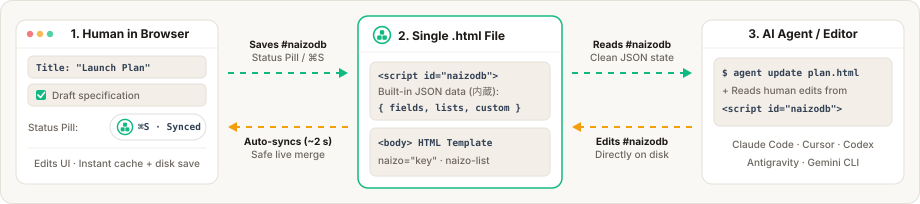
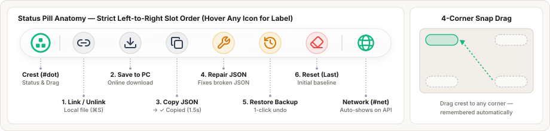

# `naizo.js` — Comprehensive Usage Reference

This guide is the complete authoring and integration reference for **`naizo.js`** (npm package `naizojs`)—the zero-dependency, self-persisting HTML built-in database (`#naizodb`) and declarative list repeater (`[naizo-list]`) for Human + AI Agent workflows.

For product vision and scope boundaries, see [PRODUCT.md](PRODUCT.md). For architectural rationale (`Dxx`) and boundary cases (`ECxx`), see [DECISIONS.md](DECISIONS.md) and [EDGE_CASES.md](EDGE_CASES.md).

---

## Table of Contents

1. [Core Mental Model: Body is Template, `#naizodb` is Data](#1-core-mental-model-body-is-template-naizodb-is-data)
2. [The `#naizodb` Canonical JSON Schema](#2-the-naizodb-canonical-json-schema)
3. [Loading `naizo.js` (CDN, Local Bundle, & ESM)](#3-loading-naizojs-cdn-local-bundle--esm)
4. [Declarative HTML Attributes Reference](#4-declarative-html-attributes-reference)
5. [Scalar Field Bindings (`naizo="key"`)](#5-scalar-field-bindings-naizokey)
6. [Declarative List Repeaters (`naizo-list` & `naizo-item`)](#6-declarative-list-repeaters-naizo-list--naizo-item)
7. [Templates (`naizo-template` vs. `data-naizo-auto-template`)](#7-templates-naizo-template-vs-data-naizo-auto-template)
8. [State Exclusion (`naizo-ignore`) vs. Export Stripping (`naizo-strip`)](#8-state-exclusion-naizo-ignore-vs-export-stripping-naizo-strip)
9. [Programmatic JavaScript API (`window.Naizo`) & Events](#9-programmatic-javascript-api-windownaizo--events)
10. [Declarative Mini-API Client (`naizo-get`, `naizo-post`, `Naizo.fetch`) & `#net` Indicator](#10-declarative-mini-api-client-naizo-get-naizo-post-naizofetch--net-indicator)
11. [Local Mode vs. Online Mode & Web-to-Local App Exchange](#11-local-mode-vs-online-mode--web-to-local-app-exchange)
12. [Two-Way Disk Sync, Live Watch, & Conflict Resolution](#12-two-way-disk-sync-live-watch--conflict-resolution)
13. [Architectural Recipes (`examples/`)](#13-architectural-recipes-examples)
14. [Vanilla HTML5 UI Patterns & Why Widget Directives Are Omitted](#14-vanilla-html5-ui-patterns--why-widget-directives-are-omitted)
15. [Local-First & AI Agent Workflows](#15-local-first--ai-agent-workflows)

---

## 1. Core Mental Model: Body is Template, `#naizodb` is Data

In Japanese, **_naizō_ (ないぞう)** carries two meanings that define the architecture of a `naizo.js` document:

- **内蔵 (_built-in / housed within_):** Every `.html` file embeds its canonical state inside `<script id="naizodb" type="application/json">` in `<head>`.
- **内臓 (_internal organs_):** `naizo.js` acts as the document's reactive internal organs, keeping the live DOM, `localStorage`, and `<script id="naizodb">` on disk synchronized.

Under decisions `D15`, `D16`, `D23`, and `D57`, `naizo.js` strictly separates **data** from **view markup** while keeping store and DOM ergonomics 100% synchronous:

1. **`<script id="naizodb">` is the canonical data:** On boot, `naizo.js` parses `#naizodb` (and any newer `localStorage` state) into an in-memory `NaizoDatabase` store and hydrates bound elements and list items in `<body>`.
2. **`<body>` is the declarative template:** When linked to a local file via the File System Access API (`showSaveFilePicker`), saving rewrites **only** the `<script id="naizodb">...</script>` block on disk (`D16`). Every other byte of the file stays untouched—so third-party runtime scripts (Tailwind Play CDN, Lucide icons, Mermaid diagrams, syntax highlighters) never pollute your file on disk or create noisy Git diffs.
3. **HTML attributes are baked only on full-HTML export (`D23`):** Live edits update the in-memory store in `O(1)` without mutating DOM attributes (`setAttribute('value', ...)`), preventing `<textarea>` cursor jumps and preserving native `form.reset()`. Full attribute baking and runtime UI stripping run only on a cloned document when calling `Naizo.exportHTML()` or `Naizo.downloadHTML()`.
4. **100% synchronous store & bound DOM operations (`D57`):** Reading and writing `store` (`Naizo.getField`, `Naizo.setField`, `Naizo.addItem`, `Naizo.updateItem`, etc.) and updating bound DOM nodes always execute synchronously (`< 0.5 ms`), preserving zero-`await` read-after-write guarantees and immediate `[naizo-item]` DOM availability, with `Naizo.batch(fn, options?)` coalescing multi-step updates and high-frequency 60fps scrubs while disk I/O (`250 ms` single-flight) and `Naizo.fetch()` remain asynchronous.

> **Golden Rule for Humans and AI Agents:** Edit `<script id="naizodb">` on disk to change **data**; edit `<body>` markup on disk to change the **view**.

<p align="center">
  
</p>

---

## 2. The `#naizodb` Canonical JSON Schema

Place `<script id="naizodb" type="application/json">` near the top of `<head>` (before `<script src="...naizo.js" defer></script>`). If omitted on an empty or new page, `naizo.js` automatically creates it in `<head>`.

```html
<head>
  <script id="naizodb" type="application/json">
    {
      "_meta": {
        "id": "release-plan-v2",
        "updatedAt": "2026-10-26T12:00:00.000Z"
      },
      "fields": {
        "title": "Q4 Launch Readiness Plan",
        "owner": "Kenji",
        "approved": false,
        "confidence": 85
      },
      "lists": {
        "tasks": [
          {
            "id": "task-1",
            "done": true,
            "title": "Verify surgical #naizodb disk writes",
            "estimate": "2h"
          }
        ]
      },
      "custom": {
        "activeTab": "checklist"
      }
    }
  </script>
  <script src="https://cdn.jsdelivr.net/npm/naizojs@latest/dist/naizo.js" defer></script>
</head>
```

### Top-Level Buckets (`NaizoDatabase`)

| Bucket   | Type                                             | Purpose                                                                                                                                                                                                                        |
| -------- | ------------------------------------------------ | ------------------------------------------------------------------------------------------------------------------------------------------------------------------------------------------------------------------------------ |
| `_meta`  | `Record<string, unknown>`                        | Metadata dictionary. `naizo.js` updates `_meta.updatedAt` (ISO-8601 timestamp) **only** when serialized content in `fields`, `lists`, or `custom` actually changes (`EC06`). Optional `_meta.id` scopes storage keys (`EC11`). |
| `fields` | `Record<string, unknown>`                        | Standalone scalar values bound via `naizo="key"` / `data-naizo="key"` outside `[naizo-item]`, or read/written via `Naizo.getField(key)` / `Naizo.setField(key, value)`.                                                        |
| `lists`  | `Record<string, Array<Record<string, unknown>>>` | Repeating arrays of plain item objects bound to `[naizo-list="name"]` containers, or manipulated via `Naizo.getList`, `setList`, `addItem`, `updateItem`, `moveItem`, and `removeItem`.                                        |
| `custom` | `Record<string, unknown>`                        | Arbitrary JSON-serializable state for custom JavaScript widgets, read/written via `Naizo.get(key)`, `Naizo.set(key, value)`, and `Naizo.delete(key)`.                                                                          |

### Pass-Through Keys (`D15`, `D58`, `EC14`)

`naizo.js` never resets `fields` or `lists` to `{}` when capturing DOM edits. Instead, the in-memory store merges bound DOM changes into existing objects and maps each rendered `[naizo-item]` DOM element to its backing item object via a `WeakMap`:

- **Unbound `fields` keys** (e.g., metadata written by an AI agent that has no matching input in `<body>`) remain intact.
- **Unbound `lists` arrays** (lists stored in `#naizodb` without a corresponding `[naizo-list]` container on the current page) remain intact.
- **Extra list-item keys** (such as agent-assigned `"id"`, `"estimate"`, `"updatedAt"`, external URLs, nested sub-arrays, or custom per-card dictionary attributes in [`examples/inventory.html`](../examples/inventory.html)) survive edits, reordering (`moveItem`), and partial updates (`updateItem`).
- **No `.sr-only` dummy bindings required (`D58`):** Never add hidden `<input class="sr-only" naizo="id">` controls just to keep extra item properties alive. Render rich HTML (`<a>`, formatted Markdown, badges, or sub-lists) into `[naizo-ignore]` containers directly from `Naizo.getList()` while `WeakMap` row bindings preserve unbound keys automatically.
- Deleting a key is always explicit via `Naizo.deleteField(key)`, `Naizo.delete(key)`, or `Naizo.removeItem(listName, index)`.

### Script-Safe `\u003c` Escaping (`D13`, `EC08`)

In HTML5, a literal `</script>` sequence inside a `<script type="application/json">` block prematurely closes the script tag and breaks the document parser. Whenever `naizo.js` serializes `#naizodb` (both in the DOM and on disk), it formats the JSON with 2-space indentation and escapes every `<` character as `\u003c`:

```javascript
JSON.stringify(db, null, 2).replace(/</g, '\\u003c');
```

`\u003c` is standard RFC 8259 JSON Unicode escaping: `JSON.parse()` decodes `\u003c` back into `<` transparently with zero data alteration, while ensuring `</script>`, `<script>`, and `<!--` in user notes are completely safe inside HTML. Outgoing HTTP `POST` bodies (`naizo-post` / `Naizo.fetch()`) use standard `JSON.stringify()` without `\u003c` escaping so webhook consumers receive clean unescaped `<` strings (`D51`).

### Validation, Own-Property Safety, & Broken-JSON Recovery (`EC04`, `EC24`, `EC33`, `EC35`, `EC38`, `EC59`, `EC62`, `EC63`)

- **Startup (`startupInvalidDb`) vs. live linked-disk (`liveDiskInvalidJson`) validation (`isInvalidDbState()`, `EC04`, `EC33`, `EC59`, `EC62`, `EC63`):** On boot (`initNaizo()`, which resets module store/script/hash state and increments a monotonic `initEpoch` generation token shared across `isCurrentEpoch(epoch)` and `isCurrentHandle(epoch, handle)` with zero hot-path overhead on synchronous store/DOM work, `D61`, `EC63`) and whenever a linked disk file is read during the ~2 s watcher, window `focus`, or pre-write check (`checkDiskForExternalChanges()` / `performSingleDiskWrite()`), `naizo.js` verifies that `#naizodb` is valid JSON whose `_meta`, `fields`, `lists`, and `custom` buckets (if present) are plain objects and every list in `lists` is an array of plain objects (`validateAndNormalizeDb()`). If `<script id="naizodb">` contains malformed JSON or an invalid bucket shape:
  1. **On startup (`startupInvalidDb = true`, `EC04`, `EC62`, `EC63`):** `naizo.js` preserves the raw `<script id="naizodb">` text untouched in the DOM, backs it up to `localStorage` (`naizodb_raw_backup_<key>`), loads any persisted IndexedDB `fileHandle` under the boot `pageKey` (querying `'readwrite'` permission without starting auto-writes or disk watching while invalid, and leaving any handle manually linked before IndexedDB finished untouched, `EC63`), hydrates in-memory state from the last good `localStorage` cache if available, and pauses both `localStorage` and disk write-back until repaired.
  2. **Mid-session on a linked disk file (`liveDiskInvalidJson = true`, `EC59`, `EC62`):** `naizo.js` isolates `liveDiskInvalidJson = true` from `startupInvalidDb` (checked together via `isInvalidDbState()`), backs up the raw broken disk `#naizodb` text to `naizodb_raw_backup_<key>`, and **immediately pauses automatic disk writes** while keeping browser `localStorage` saves, live DOM `#naizodb` updates, emergency `Naizo.downloadHTML()` snapshots (without clearing the Red pill), and `Naizo.unlink()` active.
  3. **Red Status Pill, headless diagnostics, & two recovery paths:** Both states display a red **`Invalid #naizodb JSON`** Status Pill with a 1-click **`4. Repair JSON`** (`↺ Repair`) Wrench button (or log a `console.warn` explaining how to remove `naizo-no-pill` / `data-naizo-no-pill` to expose `Repair JSON` when the pill is hidden, `EC53`, `EC62`). Clicking **`4. Repair JSON`** (`restoreConflictBackup()`) clears `startupInvalidDb` / `liveDiskInvalidJson`, latches `repairingDiskInvalidDb = true` even when unlinked or awaiting `'prompt'` permission (so clicking `1. Link Disk` / `Resume Disk Sync` / `⌘S` overwrites the broken disk `#naizodb` block on the first click), writes clean 2-space `#naizodb` JSON, and dispatches both `naizo:hydrate` and `naizo:change` (`{ scope: 'restore', source: 'api', db }`); alternatively, for `liveDiskInvalidJson`, fixing the disk file externally auto-clears the error state and merges cleanly on the next ~2 s watch or tab `focus` tick (`EC59`).
- **Prototype-pollution protection (`EC24`, `EC38`):** All internal dictionary lookups use `Object.hasOwn()` and all property assignments use `Object.defineProperty()`, so keys like `__proto__`, `constructor`, or `toString` are stored and serialized as ordinary own data properties without touching `Object.prototype`.
- **Strict JSON value validation (`EC35`):** `Naizo.set()`, `Naizo.setField()`, `Naizo.setList()`, `Naizo.addItem()`, and `Naizo.updateItem()` validate that values are finite, acyclic JSON types (`string`, finite `number`, `boolean`, `null`, plain objects, and dense arrays). Passing `undefined`, `NaN`, `Infinity`, functions, symbols, `BigInt`, class instances, or circular references logs a warning and leaves the store unchanged.

---

## 3. Loading `naizo.js` (CDN, Local Bundle, & ESM)

### Option A: npm-Backed CDN (`jsDelivr` or `unpkg` — Recommended for Standalone HTML)

Load one provider in `<head>` with `defer` (`D34`, `D39`):

```html
<!-- Readable IIFE bundle (~42.2 KB gzipped / ~188.6 KB raw, jsDelivr) -->
<script src="https://cdn.jsdelivr.net/npm/naizojs@latest/dist/naizo.js" defer></script>

<!-- Prebuilt minified IIFE bundle (~28.3 KB gzipped / 95.9 KB raw) -->
<script src="https://cdn.jsdelivr.net/npm/naizojs@latest/dist/naizo.min.js" defer></script>

<!-- Alternative: unpkg -->
<script src="https://unpkg.com/naizojs@latest/dist/naizo.js" defer></script>
```

Use `@latest` to follow published releases automatically as CDN caches refresh, pin a specific version tag for immutable artifacts, or use `https://cdn.jsdelivr.net/gh/nickosh/naizo@main/dist/naizo.js` (or local `./dist/naizo.js`) for the latest in-development build on `main`. See [PUBLISHING.md](PUBLISHING.md#cdn-urls-and-automatic-updates) for CDN caching details.

### Option B: Local File Copy (Offline & Local Repository Use)

```html
<script src="./dist/naizo.js" defer></script>
```

When an HTML file using a relative path like `../dist/naizo.js` or `./dist/naizo.js` is served online (`https://`) and a visitor clicks **`⬇ Save to PC`** (`Naizo.downloadHTML()`), `naizo.js` automatically rewrites the relative `<script src>` on the downloaded clone to `https://cdn.jsdelivr.net/npm/naizojs@latest/dist/naizo.min.js` so the downloaded file works standalone on their computer (`D41`, `EC48`).

### Option C: Side-Effect-Free ESM Import (`naizojs`)

While the browser IIFE (`dist/naizo.js`) sets `window.Naizo` / `window.NaizoDB` and auto-runs `initNaizo()` on load, the ESM entrypoint (`dist/index.mjs`) is completely side-effect free (`D25`, `EC37`, `EC49` — keeping runtime value exports strictly `Naizo`, `NaizoDB`, and `initNaizo`):

```typescript
import {
  Naizo,
  NaizoDB,
  initNaizo,
  type NaizoAPI,
  type NaizoBatchOptions,
  type NaizoDatabase,
  type NaizoFetchOptions,
  type NaizoFetchResult,
  type NaizoMeta,
} from 'naizojs';

await initNaizo();
```

To use the browser IIFE bundle without auto-initializing on `DOMContentLoaded`, add `naizo-manual` (or `data-naizo-manual`) to `<html>`, `<body>`, or the `<script>` tag and call `await Naizo.init()` when ready.

### Boot Timing with `<script defer>` & `Naizo.ready(callback)` (`D57`, `D58`, `EC57`)

By HTML5 specification, an external `<script src="...naizo.js" defer></script>` executes at `document.readyState === 'interactive'` **before** `DOMContentLoaded` callbacks fire—and inline `<script type="module">` blocks or dynamically appended scripts may execute _after_ `initNaizo()` has already finished its initial hydration. As a result, registering `window.addEventListener('naizo:hydrate', syncUi)` _inside_ a `DOMContentLoaded` listener misses the initial boot event (`EC57`):

```javascript
// Recommended Pattern 1: Naizo.ready(callback) + naizo:hydrate (external disk / cross-tab merges) & naizo:change
Naizo.ready((db) => {
  syncCustomUi(db);
});
window.addEventListener('naizo:hydrate', (e) => syncCustomUi(e.detail));
window.addEventListener('naizo:change', (e) => syncCustomUi(e.detail.db));

// Recommended Pattern 2: Attach top-level window listeners directly (never inside DOMContentLoaded)
window.addEventListener('naizo:hydrate', (e) => syncCustomUi(e.detail));
window.addEventListener('naizo:change', (e) => syncCustomUi(e.detail.db));
```

- **`Naizo.ready(callback)` contract (`EC57`):** Tracks `bootHydrated` across `initNaizo()` cycles (resetting `bootHydrated = false` at the start of `initNaizo()` and setting `bootHydrated = true` right before dispatching boot `naizo:hydrate`, including the `startupInvalidDb` boot path). When `bootHydrated === true`, `Naizo.ready(cb)` invokes `cb(store)` synchronously; when boot has not finished yet, it registers a `{ once: true }` `'naizo:hydrate'` listener on `window`.
- **Preventing pre-hydration flash & boot-time dirtying (`D45`, `D58`, `EC48`):** Match static `hidden` attributes in HTML to your initial `#naizodb` defaults (e.g., `<section data-tab-panel="metrics" hidden>`), make `[naizo-ignore]` enhancements inside `[naizo-item]` idempotent across `naizo:hydrate` and `naizo:change`, and use `"theme": "system"` with CSS `@media (prefers-color-scheme: dark)` rather than calling `Naizo.setField('theme', 'dark')` on boot (which would mark `store` dirty against `initialDiskDb` and prematurely reveal `↺ Reset`).

---

## 4. Declarative HTML Attributes Reference

`naizo.js` supports both concise **`naizo` / `naizo-*`** attributes and HTML5-compliant **`data-naizo` / `data-naizo-*`** attributes everywhere (`D08`). Every short attribute has a strict 1-to-1 `data-*` counterpart (`EC49`):

| Short Attribute                     | HTML5 `data-*` Alias                     | Placement                                                                                              | Behavior                                                                                                                                                                                                                                                                                                                                          |
| ----------------------------------- | ---------------------------------------- | ------------------------------------------------------------------------------------------------------ | ------------------------------------------------------------------------------------------------------------------------------------------------------------------------------------------------------------------------------------------------------------------------------------------------------------------------------------------------- |
| `naizo="key"`                       | `data-naizo="key"`                       | `<input>`, `<textarea>`, `<select>`, `<details>`, `[contenteditable]`, leaf element, or `[naizo-item]` | Binds the element to `db.fields["key"]` when standalone, or to `item["key"]` when inside (or on) a `[naizo-item]`. Interactive controls take seeding/reset precedence over passive plain-text leaves (`<span>`, `<h3>`) regardless of DOM order (`EC19`, `EC56`).                                                                                 |
| `naizo-list="name"`                 | `data-naizo-list="name"`                 | List container (`<div>`, `<ul>`, `<ol>`, `<tbody>`, `<table>`)                                         | Binds direct `[naizo-item]` children to `db.lists["name"]` and appends a `+ Add Item` footer unless `naizo-no-controls` is set.                                                                                                                                                                                                                   |
| `naizo-item`                        | `data-naizo-item`                        | Direct child of `[naizo-list]` (`<div>`, `<li>`, `<tr>`, etc.)                                         | Marks a repeating row or card. Receives hover `↑`, `↓`, and `×` controls unless `naizo-no-controls` is set on the parent list.                                                                                                                                                                                                                    |
| `naizo-template`                    | `data-naizo-template`                    | Direct child `<template>` inside `[naizo-list]`                                                        | Explicit HTML blueprint cloned when creating or hydrating items in `[naizo-list]` (recommended with `0` duplicated `[naizo-item]` shells in `<body>`, `D58`). If omitted, `naizo.js` auto-infers one from the first `[naizo-item]`.                                                                                                               |
| `naizo-add="name"`                  | `data-naizo-add="name"`                  | `<button>` (anywhere in document)                                                                      | Appends a blank `{}` item to `[naizo-list="name"]` and focuses the first text input in the newly created row (`EC31`).                                                                                                                                                                                                                            |
| `naizo-remove`                      | `data-naizo-remove`                      | `<button>` inside `[naizo-item]`                                                                       | Removes the enclosing `[naizo-item]` row and its backing object from `db.lists`.                                                                                                                                                                                                                                                                  |
| `naizo-move="up"` / `"down"`        | `data-naizo-move="up"` / `"down"`        | `<button>` inside `[naizo-item]`                                                                       | Moves the enclosing `[naizo-item]` row up (`index - 1`) or down (`index + 1`) in both the DOM and `db.lists`.                                                                                                                                                                                                                                     |
| `naizo-no-controls`                 | `data-naizo-no-controls`                 | On a `[naizo-list]` container                                                                          | Suppresses auto-injected `.naizo-item-tools` (`↑ ↓ ×`) and `.naizo-list-footer` (`+ Add Item`) so you can render custom controls or read-only lists.                                                                                                                                                                                              |
| `naizo-ignore`                      | `data-naizo-ignore`                      | Any element                                                                                            | Excludes the element and its entire subtree from state binding and seeding while keeping it intact in templates and exported HTML (`D12`, `EC07`).                                                                                                                                                                                                |
| `naizo-strip`                       | `data-naizo-strip`                       | Any element                                                                                            | Excludes the element and its subtree from state binding and strips it from auto-inferred list templates and `Naizo.exportHTML()` / `Naizo.downloadHTML()` (`D12`, `D47`, `EC03`, `EC07`).                                                                                                                                                         |
| `naizo-id="scope"`                  | `data-naizo-id="scope"`                  | `<html>` or `<body>`                                                                                   | Scopes `localStorage` keys (`naizodb_state_<path>::<scope>`) and IndexedDB file handles so multiple documents on `localhost` never collide (`EC11`).                                                                                                                                                                                              |
| `naizo-mode="online\|local\|auto"`  | `data-naizo-mode="online\|local\|auto"`  | `<html>` or `<body>`                                                                                   | Overrides automatic Local Mode vs. Online Mode detection (`D41`, `EC48`).                                                                                                                                                                                                                                                                         |
| `naizo-pill-corner="corner"`        | `data-naizo-pill-corner="corner"`        | `<html>` or `<body>`                                                                                   | Sets the initial Status Pill corner (`bottom-right` [default], `bottom-left`, `top-right`, or `top-left`; `<body>` overrides `<html>`, and invalid values fall back to `bottom-right`) when `localStorage` `naizodb_ui_<key>` has no saved user-dragged preference yet; preserved across `exportHTML()` / `downloadHTML()` (`D08`, `D50`, `D57`). |
| `naizo-no-pill`                     | `data-naizo-no-pill`                     | `<html>` or `<body>`                                                                                   | Skips mounting `#__naizodb_host__` (`<body>` overrides `<html>`, and `="false"` opts out) while retaining `#__naizodb_styles__`, `localStorage`, IndexedDB `fileHandle` auto-resume + ~2 s watch, and `⌘S` / `Ctrl+S` disk linking/saving; preserved across `exportHTML()` / `downloadHTML()` (`D56`, `EC53`).                                    |
| `naizo-manual`                      | `data-naizo-manual`                      | `<html>`, `<body>`, or `<script>`                                                                      | Disables automatic `initNaizo()` boot in the browser IIFE bundle (`EC37`).                                                                                                                                                                                                                                                                        |
| `naizo-get="url"`                   | `data-naizo-get="url"`                   | `<button>`, `<a>`, or any non-ignored element                                                          | Sends an HTTP `GET` request and routes the response via `naizo-into` (or hydrates full `#naizodb` when `naizo-into` is omitted, `D43`, `D51`).                                                                                                                                                                                                    |
| `naizo-post="url"`                  | `data-naizo-post="url"`                  | `<button>` or any non-ignored element                                                                  | Flushes pending edits and sends an HTTP `POST` with CORS-safelisted `Content-Type: text/plain;charset=UTF-8` (`D43`, `D51`, `EC50`).                                                                                                                                                                                                              |
| `naizo-into="target"`               | `data-naizo-into="target"`               | Element with `naizo-get` / `naizo-post`                                                                | Routes response into `field:<key>`, `list:<name>` (`Naizo.setList`), `custom:<key>`, `db`, or a DOM-only CSS `#selector` (`textContent` only, `D22`, `D51`).                                                                                                                                                                                      |
| `naizo-path="a.b.0"`                | `data-naizo-path="a.b.0"`                | Element with `naizo-get` / `naizo-post`                                                                | Extracts a nested property or integer array index from parsed JSON using `Object.hasOwn()` at each step (`EC24`, `EC38`, `EC50`).                                                                                                                                                                                                                 |
| `naizo-body="source"`               | `data-naizo-body="source"`               | Element with `naizo-post`                                                                              | Selects outgoing JSON payload: `db` (default), `fields`, `custom`, `list:<name>`, or `field:<key>` (`D43`, `D51`).                                                                                                                                                                                                                                |
| `naizo-trigger="click\|init\|load"` | `data-naizo-trigger="click\|init\|load"` | Element with `naizo-get` / `naizo-post`                                                                | Fires on `click` (default, setting `data-naizo-loading`), `init` (on boot only when the target is empty), or `load` (every boot) (`D43`, `EC50`).                                                                                                                                                                                                 |
| `naizo-cors="no-cors"`              | `data-naizo-cors="no-cors"`              | Element with `naizo-post` (without `naizo-into`)                                                       | Sends an opaque `mode: 'no-cors'` fire-and-forget webhook request when `Access-Control-Allow-Origin` is absent (`D43`, `EC50`).                                                                                                                                                                                                                   |

---

## 5. Scalar Field Bindings (`naizo="key"`)

Standalone elements with `naizo="key"` (or `data-naizo="key"`) outside `[naizo-item]` bind to `db.fields["key"]`.

### Explicit Opt-In Only (`D12`, `D15`, `EC11`, `EC49`)

`naizo.js` **never** captures unannotated inputs or falls back to `id` or `name` attributes. Only elements with `naizo="key"` or `data-naizo="key"` are bound. If an element exists in the DOM with a default value (e.g., `<input type="text" naizo="owner" value="Alex">`) and `"owner"` is not yet present in `db.fields`, `naizo.js` seeds `db.fields.owner = "Alex"` on boot.

### Supported Elements & Value Coercion (`D14`, `D22`, `D57`, `EC12`, `EC15`, `EC18`, `EC21`, `EC25`, `EC55`, `EC56`)

| Element                                                           | Stored JSON Type             | Details & Edge-Case Protections                                                                                                                                                                                                                                                                                                                                                                |
| ----------------------------------------------------------------- | ---------------------------- | ---------------------------------------------------------------------------------------------------------------------------------------------------------------------------------------------------------------------------------------------------------------------------------------------------------------------------------------------------------------------------------------------- |
| `<input type="text\|search\|email\|url\|tel\|date\|time\|color">` | `string` (or preserved type) | Reads/writes `.value`. If `#naizodb` stored a `number` or `boolean` (e.g., `3`) and the DOM string matches `String(prevVal)`, the original JSON type is preserved (`EC25`).                                                                                                                                                                                                                    |
| `<input type="number">` / `<input type="range">`                  | `number \| null`             | Coerces finite numeric input to `number`; stores `null` when the input is cleared (`""`) (`EC12`).                                                                                                                                                                                                                                                                                             |
| `<input type="checkbox">`                                         | `boolean`                    | Reads/writes `.checked`. Hydrating strings `"false"`, `"0"`, `""`, `"no"`, or `"off"` coerces to `false` rather than truthy `true` (`EC25`).                                                                                                                                                                                                                                                   |
| `<input type="radio" name="grp" value="a" naizo="choice">`        | `string`                     | All radios in the group carry `naizo="choice"`; the checked radio's `.value` is stored.                                                                                                                                                                                                                                                                                                        |
| `<textarea naizo="notes">`                                        | `string`                     | Reads/writes `.value` on live DOM; bakes `.textContent` only on the export clone so the cursor never jumps to the end while typing (`D23`, `EC12`, `EC16`).                                                                                                                                                                                                                                    |
| `<select naizo="status">`                                         | `string`                     | Always stores `string` values (use `<input type="checkbox">` for booleans). When `#naizodb` holds `""` or `null` and no `<option value="">` exists, sets `selectedIndex = -1` without warning (`EC55`, keeping `""`/`null` in `store`, Option #0 selectable, and export clean); for unknown non-empty values (e.g., `"Shipped"`), logs `console.warn` and preserves the stored value (`EC15`). |
| `<select multiple naizo="tags">`                                  | `string[]`                   | Reads/writes an array of selected `<option>` values (`EC12`).                                                                                                                                                                                                                                                                                                                                  |
| `<details naizo="panel_open">`                                    | `boolean`                    | Binds `HTMLDetailsElement.open` via a capture-phase `toggle` listener without touching child elements (`EC12`).                                                                                                                                                                                                                                                                                |
| `[contenteditable]` (`""`, `"true"`, `"plaintext-only"`)          | `string`                     | Reads and writes plain text (`textContent`) by default so untrusted strings in `#naizodb` never execute as `innerHTML` XSS (`D22`, `EC18`). `contenteditable="false"` is not treated as editable.                                                                                                                                                                                              |
| Leaf element (`<span naizo="version">1.0</span>`)                 | `string`                     | Reads/writes `textContent` only if the element has **no** non-ignored child elements (`EC12`). Passive display leaves yield seeding/reset precedence to interactive controls (`EC56`) and live-mirror sibling `naizo="key"` updates via `textContent` (`EC19`; never mutate `innerHTML`).                                                                                                      |
| `<input type="password\|file\|button\|submit\|reset\|image">`     | _Skipped_ (`EC21`)           | Always ignored with a console warning so passwords never leak into `#naizodb` and `type="file"` never throws `InvalidStateError`.                                                                                                                                                                                                                                                              |

### Safe `<select>` Rules: Blank `selectedIndex = -1` vs. Unknown Values (`EC15`, `EC55`)

- **Blank / nullable single `<select>` (`""` or `null`, `EC55`):** When `writeElementValue()` hydrates `""` or `null` onto a single `<select naizo="key">` that lacks `<option value="">`, `naizo.js` sets `el.selectedIndex = -1` and returns **without** emitting a false-positive `console.warn`. This preserves `""` / `null` in `store`, renders the `<select>` visibly blank instead of falsely showing Option #0, keeps Option #0 user-selectable (so selecting Option #0 fires `'change'`), and prevents `Naizo.exportHTML()` from baking `selected` onto Option #0. **Recommended authoring rule (`D58`):** Still include an explicit `<option value="">— Select… —</option>` placeholder on nullable `<select>` fields so users can also clear a previously chosen option back to `""`.
- **Unknown non-empty values (`EC15`):** When `#naizodb` holds a non-empty string (such as `"Shipped"` written on disk by an AI agent before the matching `<option>` exists), `naizo.js` logs a `console.warn`, leaves DOM selection untouched, and preserves `"Shipped"` in memory rather than clobbering it with `""`.
- **String-only values (`D58`):** HTML `<select>` `.value` is always a `string`. Never store raw boolean `false` or `true` for a `<select>` field in `#naizodb`—use `<input type="checkbox" naizo="flag">` for boolean toggles.

### Duplicate Bindings, Plain-Text Mirroring, & Interactive-Over-Passive Precedence (`EC12`, `EC19`, `EC56`)

- **Live plain-text mirroring (`EC19`):** Multiple elements—either standalone (`db.fields[key]`) or inside the same `[naizo-item]` (`item[key]`)—can share `naizo="key"` (for example, `<h3 naizo="name"></h3>` in a card header paired with `<input type="text" naizo="name" value="Untitled">` in an edit body). Editing the interactive control updates `store` in `O(1)` and synchronously mirrors the text to all sibling `naizo="name"` leaves via `textContent` (`D22`). Never mutate `innerHTML` on a `naizo="key"` element; use `[naizo-ignore]` for rich HTML (`<a>`, Markdown, badges).
- **Interactive-over-passive seeding & `<form>` reset precedence (`EC56`, refining `EC19`):** During blank item creation (`bindItemElementToRecord`), initial baseline capture (`buildInitialBaselineDb`), boot/dynamic subtree hydration (`hydrateSubtreeFromStore` with `seedMissingFromDom === true`), and native `<form>` reset (`handleFormReset`), `naizo.js` partitions **interactive bound elements** (`<input>`, `<select>`, `<textarea>`, `<details>`, `[contenteditable]`) ahead of **passive display leaves** (`<span naizo="name">`, `<h3 naizo="name">`), resolves defaults from interactive controls first, and then mirrors the resolved stored value back onto passive display leaves. Placing `<h3 naizo="name"></h3>` _before_ `<input naizo="name" value="Untitled">` in DOM order never overwrites `"Untitled"` or `form.reset()` defaults with `""` or stale text.
- **Native `form.reset()` support (`EC12`):** Because `naizo.js` does not mutate `defaultValue` / `defaultChecked` attributes on the live DOM during typing (`D23`), calling `form.reset()` or clicking `<button type="reset">` restores the original HTML defaults, mirrors them onto passive leaves (`EC56`), and emits `naizo:change` (`source: 'dom'`).

---

## 6. Declarative List Repeaters (`naizo-list` & `naizo-item`)

Wrap any repeating section in `naizo-list="list_name"` (or `data-naizo-list="list_name"`) and mark each direct repeating child with `naizo-item` (or `data-naizo-item`):

```html
<div naizo-list="tasks">
  <div class="task-row" naizo-item>
    <label>
      <input type="checkbox" naizo="done" />
      <span>Completed</span>
    </label>
    <label>
      <span>Task title</span>
      <input type="text" naizo="title" placeholder="Describe task..." />
    </label>
    <label>
      <span>Priority</span>
      <select naizo="priority">
        <option value="High">High</option>
        <option value="Med">Med</option>
        <option value="Low">Low</option>
      </select>
    </label>
  </div>
</div>
```

### Wrapping `<label>` Rule Inside Lists (`EC39`)

Never pair `<label for="task-input">` with `<input id="task-input">` inside a `[naizo-item]`. When `naizo.js` clones the row for multiple items, every row would share the same duplicate `id="task-input"`, causing clicks on row 3's label to toggle row 1's input. Always wrap `<label>` directly around the `<input>` or `<select>` (using a `<span class="sr-only">` for screen-reader text when visual labels are omitted, as shown in [`examples/starter.html`](../examples/starter.html) and [`examples/checklist.html`](../examples/checklist.html)).

### Self-Bound `[naizo-item]` Elements (`D14`, `EC13`, `EC46`)

For simple single-value lists (such as bullet points or tags), place `naizo="prop"` directly on the `[naizo-item]` root element itself:

```html
<ul naizo-list="highlights">
  <li naizo-item contenteditable="true" naizo="text">First highlight</li>
</ul>
```

`naizo.js` automatically excludes and preserves any `[naizo-ignore]` or `[naizo-strip]` / `[data-naizo-strip]` child elements (including the injected `.naizo-item-tools` `↑ ↓ ×` toolbar) when reading or writing `textContent` on a self-bound `[naizo-item]` (`D47`, `EC46`), so button labels and badges never leak into `db.lists.highlights[i].text` and hydrating the item never destroys its hover toolbar or `[naizo-ignore]` children.

### Valid Table Repeaters (`<table>` / `<tbody naizo-list>` / `<tr naizo-item>`, `EC13`)

HTML tables strictly forbid `<button>` or `<div>` elements as direct children of `<tbody>` or `<tr>`. When `[naizo-list]` is placed on a `<tbody>` (or `<table>`) and `[naizo-item]` is a `<tr>`:

1. `naizo.js` injects `.naizo-item-tools` (`↑ ↓ ×`) inside the **last `<td>` or `<th>`** of each `<tr naizo-item>`.
2. `naizo.js` places `.naizo-list-footer` (`+ Add Item`) **immediately after the enclosing `<table>`** element.

```html
<table>
  <thead>
    <tr>
      <th>Done</th>
      <th>Deliverable</th>
      <th>Owner</th>
    </tr>
  </thead>
  <tbody naizo-list="deliverables">
    <tr naizo-item>
      <td>
        <label><input type="checkbox" naizo="done" /></label>
      </td>
      <td>
        <label><input type="text" naizo="title" /></label>
      </td>
      <td>
        <label><input type="text" naizo="owner" /></label>
      </td>
    </tr>
  </tbody>
</table>
```

### Per-Row Radio Group Scoping (`EC13`)

If a `[naizo-item]` contains `<input type="radio" name="severity" naizo="severity" value="...">`, browsers would normally group all rows' radios together because they share `name="severity"`. `naizo.js` automatically scopes each row's radio `name` attribute to a unique per-row identifier on hydration (storing the original name in `data-naizo-radio-name`) and restores the original `name="severity"` attribute on `Naizo.exportHTML()` / `Naizo.downloadHTML()`.

### Custom List Controls & `naizo-no-controls`

By default, `naizo.js` injects a hover toolbar (`.naizo-item-tools` with `↑`, `↓`, `×`) into each `[naizo-item]` and a `.naizo-list-footer` (`+ Add Item`) below each `[naizo-list]`. To build custom toolbars (or when rendering cards/panes where default controls aren't desired, as in [`examples/notes.html`](../examples/notes.html) and [`examples/inventory.html`](../examples/inventory.html)):

1. Add `naizo-no-controls` (or `data-naizo-no-controls`) to the `[naizo-list]` container.
2. Optionally place your own buttons using `naizo-add="list_name"`, `naizo-move="up"`, `naizo-move="down"`, and `naizo-remove` inside `[naizo-item]`, or call `Naizo.addItem()` / `Naizo.removeItem()` / `Naizo.moveItem()` from JavaScript.

### Multi-Container Repeaters, `WeakMap` Row Identity, & Optional Item `id`s (`D19`, `D59`, `EC58`, `EC61`)

- **Multiple synchronized `[naizo-list="name"]` containers (`findListElements(listName)`, `EC61`):** You can render two or more `[naizo-list="tasks"]` views over the same `db.lists.tasks` array (for example, a compact sidebar checklist paired with a main detail board). `Naizo.setList()`, `Naizo.addItem()` / `[naizo-add]` (auto-focusing the first text field strictly inside the clicked container, `EC31`), `Naizo.updateItem()`, `Naizo.removeItem()`, `Naizo.moveItem()`, and user `input`/`change` edits keep every matching `[naizo-list="name"]` container in sync.
- **`WeakMap` (`itemDataMap`) row-identity lookup on `×` & `↑ ↓` (`EC61`):** Clicking `[naizo-remove]` (`×`) or `[naizo-move="up|down"]` (`↑ ↓`) resolves the target item's array index via `itemDataMap` (`WeakMap` object identity in `db.lists[name]`) before falling back to DOM child order—preventing wrong-row splices even if a third-party drag helper (such as `SortableJS`) reordered DOM nodes first.
- **Optional primitive `item.id` (`string | number`) without compulsory UUIDs (`D19`, `EC58`):** `naizo.js` never auto-stamps unrequested UUIDs into `_meta.id` or `[naizo-list]` items. Including a unique primitive `"id"` (non-empty `string` or finite `number`) on multi-field cards/rows unlocks Path A `O(N)` 3-way per-item merging across concurrent Human + AI additions, deletions, reorders, and per-property live edits, while `id`-less checklists still merge disjoint row edits and appends via Path B (see Section 12).

---

## 7. Templates (`naizo-template` vs. `data-naizo-auto-template`)

Every `[naizo-list]` needs an HTML blueprint for rendering items from `#naizodb` and appending new rows (`D14`, `EC09`):

### 1. Auto-Inferred Template (`data-naizo-auto-template="true"` — Default)

If you do **not** author a `<template>` tag inside `[naizo-list]`, `naizo.js` automatically clones the first `[naizo-item]` child on boot, clears its bound values (`clearElementValue()`), strips `[naizo-strip]` / `[data-naizo-strip]` controls while preserving `[naizo-ignore]` subtrees (`D47`, `EC07`), and inserts `<template naizo-template data-naizo-auto-template="true">` into the list.

- **On future boots:** Because `data-naizo-auto-template` is marked as auto-generated, `naizo.js` regenerates it from the first `[naizo-item]` whenever the list has items—so if you or an AI agent edit the `[naizo-item]` markup in `<body>`, the template automatically picks up your new markup (`EC09`).
- **On `Naizo.exportHTML()` / `Naizo.downloadHTML()`:** If the list currently has $\ge 1$ item, `template[data-naizo-auto-template]` is stripped from the exported HTML to keep the markup clean. If the user deleted every item in the list ($0$ items remaining), `template[data-naizo-auto-template]` is **kept** in the exported HTML so the empty list never loses its item blueprint (`EC09`).

### 2. Explicit Authored Template (`<template naizo-template>` — Recommended for Multi-Item Lists, `D16`, `D58`)

For multi-item tables, card boards, and studios—or whenever a list may start with `0` items—prefer authoring a **single explicit `<template naizo-template>`** blueprint inside `[naizo-list]` with **`0` duplicated static `[naizo-item]` shells** in `<body>` while `<script id="naizodb">` holds the canonical initial items (`D16`, `D58`):

```html
<div naizo-list="risks">
  <template naizo-template>
    <div class="risk-card" naizo-item>
      <label><input type="text" naizo="summary" placeholder="Risk description..." /></label>
      <label>
        <select naizo="impact">
          <option value="">— Select… —</option>
          <option value="Low">Low</option>
          <option value="High">High</option>
        </select>
      </label>
    </div>
  </template>
</div>
```

Authoring one `<template naizo-template>` with `0` static `[naizo-item]` shells in `<body>` eliminates duplicated HTML markup, prevents pre-hydration flashes of placeholder cards before `<script defer>` runs, works seamlessly when `db.lists.risks` starts empty (`[]`), and is always preserved untouched across boot and `Naizo.exportHTML()`.

---

## 8. State Exclusion (`naizo-ignore`) vs. Export Stripping (`naizo-strip`)

Decisions `D12` and `D47` (`EC03`, `EC07`, `EC23`, `EC29`) separate **excluding elements from state binding while keeping them in exported HTML** (`naizo-ignore`) from **stripping runtime or hosted-only elements on export** (`naizo-strip`):

| Attribute                            | Bound to `#naizodb`? | Preserved in Auto-Templates? | Preserved in `exportHTML()` / `downloadHTML()`? | Hidden in `@media print`? | Typical Use Case                                                                                                                                               |
| ------------------------------------ | -------------------- | ---------------------------- | ----------------------------------------------- | ------------------------- | -------------------------------------------------------------------------------------------------------------------------------------------------------------- |
| `naizo-ignore` / `data-naizo-ignore` | **No** (subtree)     | **Yes** (`EC07`)             | **Yes** (`EC07`)                                | No (author controls CSS)  | Search inputs, filter dropdowns, custom JS widgets (`Naizo.get`/`set`), decorative card buttons/modals                                                         |
| `naizo-strip` / `data-naizo-strip`   | **No** (subtree)     | **No** (stripped)            | **No** (stripped, `D47`, `EC03`)                | **Yes** (`EC29`)          | Hosted-only analytics scripts (`<script ... naizo-strip>`), web demo banners, transient overlays, and auto-injected `.naizo-item-tools` / `.naizo-list-footer` |

- Placing `naizo-ignore` or `naizo-strip` on any container excludes both the element itself and all descendants (`el.closest('[naizo-ignore], [data-naizo-ignore], [naizo-strip], [data-naizo-strip]')`, `EC23`) from hydration, initial DOM seeding, and `input`/`change` capture.
- When a visitor exports or downloads a hosted page via **`⬇ Save to PC`** (`Naizo.downloadHTML()` / `Naizo.exportHTML()`), any element with `naizo-strip` or `data-naizo-strip` (such as a web analytics beacon or hosted banner, alongside `#__naizodb_host__`, `#__naizodb_styles__`, and injected list controls) is cleanly removed from the downloaded `.html` file (`D47`).
- When printing a spec or saving to PDF (`Cmd+P` / `Ctrl+P`), `@media print` rules automatically hide the Shadow DOM status pill (`#__naizodb_host__`) and all `[naizo-strip]` / `[data-naizo-strip]` elements (`EC29`).

---

## 9. Programmatic JavaScript API (`window.Naizo`) & Events

`window.Naizo` (aliased as `window.NaizoDB`) exposes the full store, batching/readiness helpers, Mini-API Client, and persistence lifecycle (`D14`, `D15`, `D21`, `D40`, `D41`, `D43`, `D51`, `D56`, `D57`):

### Method Reference (`NaizoAPI`)

| Method                                           | Return Type                      | Description                                                                                                                                                                                                                                                                                                                                                                                                                                                                                                                                                                                                                                                                                                                                                                                                                                                                                                                                                                                                                                                                                                       |
| ------------------------------------------------ | -------------------------------- | ----------------------------------------------------------------------------------------------------------------------------------------------------------------------------------------------------------------------------------------------------------------------------------------------------------------------------------------------------------------------------------------------------------------------------------------------------------------------------------------------------------------------------------------------------------------------------------------------------------------------------------------------------------------------------------------------------------------------------------------------------------------------------------------------------------------------------------------------------------------------------------------------------------------------------------------------------------------------------------------------------------------------------------------------------------------------------------------------------------------- |
| `Naizo.init()`                                   | `Promise<void>`                  | Initializes (or re-initializes) `naizo.js`: resets `store`, `storeInitialized`, `startupInvalidDb`, `liveDiskInvalidJson`, `trackedDbScriptEl`, `lastSerializedContent`, `itemDataMap`, `writeInFlightPromise`, `writeQueued`, `bootHydrated`, `lastKnownDiskRaw`, `lastDiskDb`, `#net` counters, `data-naizo-loading` attributes, and event/batch queues while advancing the monotonic `initEpoch` fence (`isCurrentEpoch` / `isCurrentHandle`, also incremented by `window.__naizoCleanup`, fencing all in-flight IndexedDB, disk watch/write/link, `fetch`, clipboard, and `<form>` reset continuations with zero hot-path overhead; `D61`, `EC11`, `EC62`, `EC63`), mounts Shadow DOM pill (unless `naizo-no-pill` / `data-naizo-no-pill` is active), infers templates, attaches listeners with `AbortController` cleanup, resolves `#naizodb` vs. `localStorage`, hydrates DOM, sets `bootHydrated = true` and emits `naizo:hydrate`, checks IndexedDB `fileHandle` (skipping boot handle setup if the user already linked manually while IDB was pending), and fires `naizo-trigger="init\|load"` requests. |
| `Naizo.ready(callback)`                          | `void`                           | Invokes `callback(db)` synchronously with the live `NaizoDatabase` when initial boot hydration (`bootHydrated`) has already completed (including the `startupInvalidDb` boot path), or attaches a `{ once: true }` `'naizo:hydrate'` listener on `window` when called before `initNaizo()` finishes (`D57`, `EC57`).                                                                                                                                                                                                                                                                                                                                                                                                                                                                                                                                                                                                                                                                                                                                                                                              |
| `Naizo.batch(fn, options?)`                      | `T`                              | Executes `fn()` synchronously (`options?: NaizoBatchOptions` `{ silent?: boolean; deferPersist?: boolean }`, nestable via `batchDepth`, and `try/finally`-safe if `fn()` throws), updating `store` and bound DOM elements synchronously on each inner call while suppressing intermediate `flushPersistence()` and `naizo:change` dispatches (`D57`, `EC54`). On outermost exit when dirty, persists once (`schedulePersist()` if `deferPersist: true`, or `flushPersistence(true)` by default) and—unless `silent: true` (or all dirty writes occurred inside `silent: true` inner batches)—emits one `{ scope: 'batch', action: 'batch', source: 'api', db }` `naizo:change` event.                                                                                                                                                                                                                                                                                                                                                                                                                             |
| `Naizo.get(key?)`                                | `unknown`                        | Returns an `O(1)` uncloned, unfrozen live read-only reference to `db.custom[key]` when `key` is provided, or the live `NaizoDatabase` (`{ _meta, fields, lists, custom }`) when `key` is omitted (`D59` — never mutate returned objects/arrays directly; mutate via `Naizo.set*`, `updateItem`, `addItem`, `setList`, or `batch`).                                                                                                                                                                                                                                                                                                                                                                                                                                                                                                                                                                                                                                                                                                                                                                                |
| `Naizo.set(key, value)`                          | `void`                           | Validates JSON value (`EC35`), deep-clones and stores `db.custom[key]`, dispatches `naizo:change` (`{ scope: 'custom', key, value, source: 'api', db }`), and flushes persistence.                                                                                                                                                                                                                                                                                                                                                                                                                                                                                                                                                                                                                                                                                                                                                                                                                                                                                                                                |
| `Naizo.delete(key)`                              | `void`                           | Removes `db.custom[key]` if present, dispatches `naizo:change` (`{ scope: 'custom', action: 'delete', key, source: 'api', db }`), and flushes persistence.                                                                                                                                                                                                                                                                                                                                                                                                                                                                                                                                                                                                                                                                                                                                                                                                                                                                                                                                                        |
| `Naizo.getField(key)`                            | `unknown`                        | Returns `db.fields[key]`.                                                                                                                                                                                                                                                                                                                                                                                                                                                                                                                                                                                                                                                                                                                                                                                                                                                                                                                                                                                                                                                                                         |
| `Naizo.setField(key, value)`                     | `void`                           | Validates JSON value (`EC35`), sets `db.fields[key]`, updates all bound standalone `[naizo="key"]` elements in the DOM, dispatches `naizo:change` (`{ scope: 'fields', key, value, source: 'api', db }`), and flushes persistence.                                                                                                                                                                                                                                                                                                                                                                                                                                                                                                                                                                                                                                                                                                                                                                                                                                                                                |
| `Naizo.deleteField(key)`                         | `void`                           | Deletes `db.fields[key]`, clears bound standalone `[naizo="key"]` DOM elements (`clearElementValue`), dispatches `naizo:change` (`{ scope: 'fields', action: 'delete', key, source: 'api', db }`), and flushes persistence.                                                                                                                                                                                                                                                                                                                                                                                                                                                                                                                                                                                                                                                                                                                                                                                                                                                                                       |
| `Naizo.getList(listName)`                        | `Array<Record<string, unknown>>` | Returns an `O(1)` uncloned, unfrozen live read-only reference to `db.lists[listName]` (or `[]` if not found; `D59` — never mutate the returned array or item objects in place; use `updateItem`, `addItem`, `moveItem`, `removeItem`, `setList`, or `batch`).                                                                                                                                                                                                                                                                                                                                                                                                                                                                                                                                                                                                                                                                                                                                                                                                                                                     |
| `Naizo.setList(listName, items)`                 | `void`                           | Validates that `items` is an array of plain JSON-serializable objects, deep-clones into `db.lists[listName]`, reconciles/re-renders all `[naizo-list="listName"]` containers (preserving pass-through keys and auto-inferred `<template>` blueprints), dispatches `naizo:change` (`{ scope: 'lists', action: 'set', list, value, source: 'api', db }`), and flushes persistence (`D43`, `EC61`).                                                                                                                                                                                                                                                                                                                                                                                                                                                                                                                                                                                                                                                                                                                  |
| `Naizo.addItem(listName, itemData?)`             | `void`                           | Validates `itemData` (defaults to `{}`), appends a new `[naizo-item]` DOM node across all `[naizo-list="listName"]` containers if present (without stealing focus, `EC31`, `EC61`), pushes to `db.lists[listName]`, and dispatches `naizo:item` and `naizo:change` (`{ scope: 'lists', action: 'add', list, index, value, source: 'api', db }`).                                                                                                                                                                                                                                                                                                                                                                                                                                                                                                                                                                                                                                                                                                                                                                  |
| `Naizo.updateItem(listName, index, partialData)` | `void`                           | Validates `partialData`, shallow-merges its keys into `db.lists[listName][index]` (preserving untouched keys), updates matching bound fields in that row's DOM across all `[naizo-list="listName"]` containers (`EC61`), dispatches `naizo:change` (`{ scope: 'lists', action: 'update', list, index, value, source: 'api', db }`), and flushes persistence.                                                                                                                                                                                                                                                                                                                                                                                                                                                                                                                                                                                                                                                                                                                                                      |
| `Naizo.moveItem(listName, fromIndex, toIndex)`   | `void`                           | Moves the item in `db.lists[listName]` and reorders the corresponding `[naizo-item]` DOM node in place across all `[naizo-list="listName"]` containers (preserving `WeakMap` references and returning early without scheduling persistence when indices are equal or out of bounds, `EC61`, `EC62`), dispatches `naizo:change` (`{ scope: 'lists', action: 'move', list, fromIndex, toIndex, source: 'api', db }`), and flushes persistence.                                                                                                                                                                                                                                                                                                                                                                                                                                                                                                                                                                                                                                                                      |
| `Naizo.removeItem(listName, index)`              | `void`                           | Removes `db.lists[listName][index]` and its `[naizo-item]` DOM element across all `[naizo-list="listName"]` containers (returning early without scheduling persistence when `index` is out of bounds, `EC61`, `EC62`), dispatches `naizo:change` (`{ scope: 'lists', action: 'remove', list, index, source: 'api', db }`), and flushes persistence.                                                                                                                                                                                                                                                                                                                                                                                                                                                                                                                                                                                                                                                                                                                                                               |
| `Naizo.fetch(url, options?)`                     | `Promise<NaizoFetchResult>`      | Reveals `#net`, runs an HTTP request (`options: { method?, into?, path?, body?, headers?, mode?, signal? }`), routes valid `2xx` responses via `options.into` when provided (backing up non-empty `store` to `naizodb_backup_<key>` before `into: 'db'` replacement `EC59`, while keeping omitted `options.into` non-mutating across all HTTP methods so callers can inspect/transform parsed `data` without mutating `#naizodb`, whereas declarative `naizo-get` without `naizo-into` hydrates full `#naizodb` when the payload matches `{ _meta, fields, lists, custom }`, `D51`, `D52`), updates `#net`, dispatches `naizo:fetch`, and resolves `{ url, method, ok, status, target, data, error }` without throwing (`D43`, `D61`, `EC50`, `EC63` — if `Naizo.init()` or `window.__naizoCleanup` advances `initEpoch` mid-flight, resolves `{ ok: false, error: 'Aborted due to Naizo re-initialization' }` without mutating the new epoch's `store`, DOM, `#net`, or `naizo:fetch` listeners).                                                                                                                |
| `Naizo.bind(root?)`                              | `void`                           | Hydrates bound elements inside a dynamically inserted DOM subtree (`root` defaults to `document`) from the store without overwriting existing stored values with DOM defaults (scheduling persistence only when seeding missing defaults actually mutates `store`, `EC59`), reveals `#net` if API attributes exist, and runs `naizo-trigger="init\|load"` inside `root` (`D21`, `D43`, `EC20`).                                                                                                                                                                                                                                                                                                                                                                                                                                                                                                                                                                                                                                                                                                                   |
| `Naizo.save()`                                   | `Promise<boolean>`               | Immediately flushes pending capture (including deferred `Naizo.batch(fn, { deferPersist: true })` edits) to `localStorage` and `#naizodb`, and if a `fileHandle` is linked, awaits the single-flight surgical disk write (`EC36`, skipping `createWritable()` when the on-disk `#naizodb` block already matches so `mtime` is preserved, `EC59`). Returns `true` when the disk write (or unlinked cache flush) succeeded.                                                                                                                                                                                                                                                                                                                                                                                                                                                                                                                                                                                                                                                                                         |
| `Naizo.reset()`                                  | `void`                           | If the store differs from the initial boot baseline (`initialDiskDb`), backs up current state to `naizodb_backup_<key>` (**`↺ Restore`**), resets `store` to `initialDiskDb` locally without re-firing HTTP requests (`D51`), clears `naizodb_state_<key>`, re-hydrates DOM, and emits `naizo:hydrate` + `naizo:change` (`{ scope: 'reset', source: 'api', db }`) (`D41`, `EC48`).                                                                                                                                                                                                                                                                                                                                                                                                                                                                                                                                                                                                                                                                                                                                |
| `Naizo.link()`                                   | `Promise<boolean>`               | Prompts or resumes `FileSystemFileHandle` `readwrite` access from a user gesture (`connectOrResumeDisk()`, using URL-decoded `suggestedName`, a rename-friendly `window.confirm()` wrong-file link guard on non-empty conflicting `#naizodb` files `EC60`, and `isCurrentHandle` / `isCurrentEpoch` fencing across mid-prompt `Naizo.unlink()` or `Naizo.init()` `EC63`) and writes `#naizodb` to disk, symmetric with `Naizo.unlink()` (`D56`, `EC53`). Resolves `true` only when a `'granted'` `fileHandle` completes `writeToDisk()`; resolves `false` when `isInvalidDbState()` is active (`startupInvalidDb` or `liveDiskInvalidJson`, unless `repairingDiskInvalidDb` was latched by `4. Repair JSON`, `EC62`), permission remains `'prompt'`/`'denied'` or throws, the handle/epoch changed mid-prompt (`EC63`), the user cancels `showSaveFilePicker()` or `EC28` / wrong-file confirmation, `writeToDisk()` fails, or non-FSAA browsers fall back to `Naizo.downloadHTML()` (`EC02`).                                                                                                                    |
| `Naizo.unlink()`                                 | `Promise<void>`                  | Synchronously stops the ~2 s disk watcher, clears the active `fileHandle`, updates the status pill immediately to `Browser Cache · Not Linked` (or `Saved in Browser` in Online Mode, or `Invalid #naizodb JSON` on `startupInvalidDb`), and deletes the stored handle from IndexedDB `NaizoDB_Handles` under the captured `pageKey` (`EC62`, `EC63`).                                                                                                                                                                                                                                                                                                                                                                                                                                                                                                                                                                                                                                                                                                                                                            |
| `Naizo.copyJSON()`                               | `Promise<string>`                | Flushes pending state, writes the 2-space formatted `#naizodb` JSON string to `navigator.clipboard.writeText()` when available, and returns the JSON string (`D27`).                                                                                                                                                                                                                                                                                                                                                                                                                                                                                                                                                                                                                                                                                                                                                                                                                                                                                                                                              |
| `Naizo.exportHTML()`                             | `string`                         | Flushes pending state, clones the document, bakes form attributes (`value`, `checked`, `selected`, `open`, `textContent`), restores radio `name` attributes, preserves `naizo-no-pill` and `naizo-pill-corner` attributes, strips `[naizo-strip]` / `[data-naizo-strip]`, in-flight `data-naizo-loading` attributes, and non-empty `data-naizo-auto-template`, and returns `<!DOCTYPE html>\n...`. In Online Mode, also rewrites relative `naizo(.min).js` script tags to `dist/naizo.min.js` on the npm CDN and strips `naizo-mode="online"`.                                                                                                                                                                                                                                                                                                                                                                                                                                                                                                                                                                    |
| `Naizo.downloadHTML(filename?)`                  | `string`                         | Flushes pending state, generates a portable standalone HTML snapshot (always rewriting relative `naizo(.min).js` script tags to `https://cdn.jsdelivr.net/npm/naizojs@latest/dist/naizo.min.js`, preserving `naizo-no-pill` and `naizo-pill-corner`, and stripping `naizo-mode="online"`), triggers a browser `.html` file download (`URL.revokeObjectURL` cleanup), and returns the HTML string (`D41`, `D60`, `EC36`, `EC48`, `EC62` — setting Green `Saved to PC · Ready for Local Mode` in Online Mode, keeping `#dot` Amber `'cached'` `Browser Cache · Not Linked` with `1a. Link Disk` visible + flashing `✓ Downloaded HTML Snapshot` on `#pill-tooltip` in unlinked Local Mode `!fileHandle`, and keeping the pill Red during `liveDiskInvalidJson` emergency downloads).                                                                                                                                                                                                                                                                                                                                |

### Fast Read-Only View Semantics on `Naizo.get()` & `Naizo.getList()` (`D57`, `D59`)

`Naizo.get()` and `Naizo.getList()` are designed to be called freely inside 60fps search filters, coupled `<input type="range">` handlers, and `naizo:change` renderers (`< 0.5 ms`). To avoid `O(N)` deep-cloning allocations and GC churn on every keystroke—and to avoid `Object.freeze()` breaking caller utilities—both getters return **`O(1)` uncloned, unfrozen live references** into the in-memory `store` (`D59`):

- **Treat returned objects and arrays strictly as read-only views:** Never mutate `Naizo.getList('tasks')[0].done = true`, `items.push(...)`, or `Naizo.get('prefs').compact = true` directly in place, because direct mutation bypasses JSON validation (`EC35`), bound DOM propagation, `naizo:change` events, and `#naizodb` / disk persistence.
- **Always write through mutator APIs:** Clone (`structuredClone(...)` or `{ ...obj }` / `[...arr]`) when preparing nested values and commit changes via `Naizo.set()`, `Naizo.setField()`, `Naizo.updateItem()`, `Naizo.addItem()`, `Naizo.moveItem()`, `Naizo.removeItem()`, `Naizo.setList()`, or `Naizo.batch()`.

### Custom Window Events (`EC40`, `EC54`, `EC57`)

Listen on `window` (at top level, or pair with `Naizo.ready(fn)` per `EC57`) to synchronize custom visualizations, charts, counters, or sidebars:

```javascript
// 1. Safe boot readiness (runs synchronously if already hydrated, or once on boot naizo:hydrate)
Naizo.ready((db) => {
  renderCustomDashboard(db);
});

// 2. Fired on initial boot, external disk merge, cross-tab storage sync, full-DB fetch, ↺ Restore, and ↺ Reset
window.addEventListener('naizo:hydrate', (e) => {
  const db = e.detail; // Full NaizoDatabase: { _meta, fields, lists, custom }
  renderCustomDashboard(db);
});

// 3. Fired whenever a bound input changes, ↺ Restore / Repair JSON runs, or Naizo.set / setField / setList / addItem / updateItem / moveItem / removeItem / batch / reset is called
window.addEventListener('naizo:change', (e) => {
  // e.detail: {
  //   scope: 'fields' | 'lists' | 'custom' | 'db' | 'batch' | 'reset' | 'restore',
  //   action?: 'update' | 'add' | 'remove' | 'move' | 'set' | 'delete' | 'batch',
  //   list?: string,
  //   key?: string,
  //   index?: number,
  //   fromIndex?: number,
  //   toIndex?: number,
  //   value?: unknown,
  //   source: 'dom' | 'api',
  //   db: NaizoDatabase
  // }
  renderCustomDashboard(e.detail.db);
});

// 4. Fired when a new [naizo-item] DOM element is appended to a list
window.addEventListener('naizo:item', (e) => {
  const { list, item, data, index } = e.detail;
  console.log(`Added row #${index} to ${list}:`, item, data);
});

// 5. Fired after every declarative naizo-get / naizo-post or Naizo.fetch() call completes
window.addEventListener('naizo:fetch', (e) => {
  const { url, method, ok, status, target, data, error } = e.detail;
  if (!ok) console.warn(`Request failed (${status}):`, error);
});
```

### `naizo:change` Payload Symmetry, Non-Reentrant FIFO Queue, & `Naizo.batch()` (`D57`, `EC54`)

1. **DOM vs. API `e.detail` symmetry (`index`, `action`, `source`, `EC54`):**
   - **`source: 'dom' | 'api'`:** Every `naizo:change` event sets `source: 'dom'` for user-initiated DOM edits (`input`, `change`, `<details>` `toggle`, and `<form>` `reset`) and `source: 'api'` for programmatic `Naizo.*` calls, `Naizo.batch()`, `Restore Backup`, and store-mutating `naizo-get` / `Naizo.fetch()`.
   - **List-edit `index` & `action: 'update'` symmetry:** Editing a bound input inside `[naizo-item]` resolves `index = db.lists[listName].indexOf(rowObj)` and emits `{ scope: 'lists', action: 'update', list: listName, index, key, value, source: 'dom', db }` (matching `Naizo.updateItem()`'s `index` and `action: 'update'`), so incremental row renderers can update just `rows[e.detail.index]` for both user typing and programmatic updates.
2. **Non-reentrant FIFO `dispatchChangeEvent()` queue (`EC54`):**
   - If a `naizo:change` listener invokes `Naizo.set()`, `Naizo.setField()`, `Naizo.updateItem()`, or another mutator while an active `naizo:change` dispatch is still on the call stack, `naizo.js` **enqueues** `{ ...detail, db: store }` in FIFO order instead of recursing mid-listener, and drains queued events sequentially in a `try/finally` loop right after the current `window.dispatchEvent` returns.
   - Re-entrant draining is capped at **`10` passes** (`MAX_REENTRANT_CHANGE_PASSES = 10`); exceeding the cap logs a `console.warn` cycle warning and clears any remaining queued events (also reset cleanly on `Naizo.init()` and teardown). Because nested mutations never re-enter an active render pass, custom listeners do not need fragile `if (syncing) return;` guards that could silently drop follow-up updates.
3. **Nestable synchronous batching (`Naizo.batch<T>(fn: () => T, options?: NaizoBatchOptions): T`):**
   - Inside `fn()`, all `store` mutations and bound DOM updates (`propagateStandaloneKey`, `propagateItemKey`, `addItem` row creation, `setList`) run **synchronously** so DOM measurements and read-after-write queries remain immediate, while intermediate `flushPersistence()` and `naizo:change` calls are suppressed until the outermost `Naizo.batch()` exits (`batchDepth === 0`, decremented safely in `finally` if `fn()` throws):
     - **Default (`Naizo.batch(fn)`):** Flushes `#naizodb` + `localStorage` synchronously once (`flushPersistence(true)`) and emits one `{ scope: 'batch', action: 'batch', source: 'api', db }` event if any mutation dirtied the store.
     - **Silent derived writes (`{ silent: true }`):** Persists dirty mutations on exit while suppressing `naizo:change` (when nested inside an outer batch, `naizo:change` is also suppressed if _every_ dirty write occurred inside `silent: true` inner batches).
     - **60fps sliders & canvas drags (`{ deferPersist: true }`):** Updates `store` and bound DOM synchronously on every frame, emits `{ scope: 'batch', action: 'batch', source: 'api', db }`, and defers `JSON.stringify` + `localStorage.setItem` via `schedulePersist()` (`150 ms` debounce—still flushed synchronously by `Naizo.save()`, `Naizo.exportHTML()`, `Naizo.downloadHTML()`, `Naizo.copyJSON()`, `⌘S` / `Ctrl+S`, and `pagehide` / `visibilitychange: hidden`).

```javascript
// Atomic multi-scope mutation: 1 JSON serialize + 1 naizo:change ({ scope: 'batch', action: 'batch', source: 'api' })
const newId = Naizo.batch(() => {
  const id = 'note-' + Date.now();
  Naizo.addItem('notes', { id, title: 'Untitled', body: '' });
  Naizo.set('activeNoteId', id);
  return id;
});
```

---

## 10. Declarative Mini-API Client (`naizo-get`, `naizo-post`, `Naizo.fetch`) & `#net` Indicator

Single-file `naizo.js` applications often need to seed or refresh `#naizodb` from an HTTP endpoint (GitHub REST APIs, static `.json` presets, or a local agent server on `http://localhost`) or push `#naizodb` state to webhooks (Slack, Discord, n8n, Zapier, Make, Google Apps Script). Decision `D43` (hardened by `D50` and `D51`, `EC50`) ships a store-first, XSS-safe Mini-API Client directly inside `naizo.js` with zero extra `<script>` tags:

```html
<!-- 1. Seed a repeating list once on first boot only when empty (never clobbers user edits on reload) -->
<div
  naizo-get="https://api.github.com/repos/nickosh/naizo/issues"
  naizo-into="list:issues"
  naizo-trigger="init"
></div>

<!-- 2. Pull a nested JSON field on button click using prototype-safe dot-path extraction -->
<button
  type="button"
  naizo-get="https://api.example.com/release.json"
  naizo-path="latest.tag"
  naizo-into="field:target_version"
>
  Sync Latest Tag
</button>

<!-- 3. Push #naizodb fields to a webhook using CORS-safelisted text/plain;charset=UTF-8 -->
<button type="button" naizo-post="https://hooks.example.com/triage" naizo-body="fields">
  Send Summary
</button>
```

### Target Routing (`naizo-into`) & Store-First Guarantees (`D15`, `D22`, `D51`, `EC50`)

- **`naizo-into="field:<key>"`:** Validates the extracted JSON value and calls `Naizo.setField(key, value)`, updating `db.fields[key]`, propagating to all bound `[naizo="key"]` elements, and persisting.
- **`naizo-into="list:<name>"`:** Validates that the extracted value is an array of plain JSON-serializable objects and calls `Naizo.setList(name, items)`, replacing or clearing `[naizo-list="name"]` while preserving pass-through item keys (`id`, `html_url`, etc.) and auto-inferred `<template>` blueprints.
- **`naizo-into="custom:<key>"`:** Validates the JSON value and calls `Naizo.set(key, value)`.
- **`naizo-into="db"` (or omitted `naizo-into` on declarative `naizo-get`):** Validates that the payload has at least one top-level `NaizoDatabase` bucket (`_meta`, `fields`, `lists`, `custom`) and passes `validateAndNormalizeDb()`, saves any non-empty current `store` to `naizodb_backup_<key>` (`5. Restore Backup` / `↺ Restore`) before whole-store replacement (`EC59`), then hydrates `store` and the DOM and persists.
- **Omitted `naizo-into` on declarative `naizo-post` and omitted `options.into` on programmatic `Naizo.fetch(url, options?)` (`D51`, `D52`):** Acts as a **non-mutating request**—driving `#net`, extracting optional `path`, and returning `{ ok, status, target: null, data, error }` (tolerating `204 No Content`, webhook acknowledgement JSON, or arbitrary external `GET` JSON payloads before custom transformation) without overwriting `store` unless `into: 'db'` (or another `into` target) is explicitly specified.
- **`naizo-into="#selector"` (or any CSS selector):** Writes to matching non-ignored DOM elements (`!isIgnoredElement(el)` — `[naizo-ignore]` and `[naizo-strip]` subtrees are intentionally skipped so custom widgets stay isolated, `EC50`; unbound display elements without `naizo="key"` already stay out of `#naizodb`, `D60`) strictly via `writeElementValue()` / `textContent` (formatting objects/arrays with `JSON.stringify(val, null, 2)`)—**never** `innerHTML` (`D22`, `EC18`). Selector targets are transient DOM previews and do not write into `#naizodb`; if a selector matches a `[naizo]`-bound element, `naizo.js` logs a `console.warn` pointing to `naizo-into="field:<key>"` (`D51`).

### Triggers, CORS-Safelisted `POST` Payloads, & Export Hygiene (`EC50`)

- **Trigger modes (`naizo-trigger`):**
  - `"click"` (default): Fires on click (with list item `↑ ↓ ×` / `+ Add Item` controls taking precedence over ancestor request attributes, `D51`). Sets `data-naizo-loading="true"` and `disabled` while in flight; `Naizo.exportHTML()` / `Naizo.downloadHTML()` strips runtime loading/disabled markers if exported mid-flight.
  - `"init"`: Fires at the end of `initNaizo()` **only when the target field/list/custom bucket is currently empty**, so reloading (`F5`) never overwrites user edits in `#naizodb`.
  - `"load"`: Fires at the end of `initNaizo()` on every page load for live status feeds.
- **CORS-safelisted `POST` (`naizo-body` & `naizo-cors`):** Before sending a `POST`, `naizo.js` flushes any pending `150 ms` input debounce and sends standard `JSON.stringify()` with `Content-Type: text/plain;charset=UTF-8`—a Fetch CORS-safelisted header that avoids `OPTIONS` preflight failures from `file://` (`Origin: null`). `naizo-body` accepts `"db"` (default), `"fields"`, `"custom"`, `"list:<name>"`, or `"field:<key>"` (while programmatic `Naizo.fetch(url, { body })` sends string `body` values verbatim or JSON-stringifies objects/arrays, `D51`). For blind webhooks that accept `POST` without returning `Access-Control-Allow-Origin`, add `naizo-cors="no-cors"` (with omitted `naizo-into`).
- **Non-destructive error handling (`!res.ok` & `Object.hasOwn`):** Non-`2xx` HTTP responses (`4xx`/`5xx`), invalid JSON, missing `naizo-path` keys (traversed strictly via `Object.hasOwn()`, `EC24`), and network/CORS errors leave `#naizodb` untouched, turn `#net` red, and resolve `{ ok: false, status, error }`.

### Rightmost Wired-Globe Network Indicator (`#net`, `D43`, `D50`, `EC36`)

To keep the main Status Pill `#dot` and `#status` exclusively truthful about **storage durability** (`Synced to Disk` vs. `Saved in Browser`, `EC36`), network activity uses a dedicated **`18×18px` borderless 3D wired-globe SVG indicator (`#net`)** at the rightmost end of the pill:

- **Smart auto-show:** `#net` (and its `1px` `#net-sep` divider) stays hidden (`display: none`) on pages that do not use the API client, and automatically appears when any non-ignored `[naizo-get]` / `[naizo-post]` element is present or when `Naizo.fetch()` is called.
- **Three states (respecting `@media (prefers-reduced-motion: reduce)`, `D50`, `D51`):**
  1. **Idle (`title="API idle"`):** Calm Shared Light Green wires (`rgba(16, 185, 129, 0.38)`).
  2. **Active (`title="API active"`):** Bright Emerald (`#10b981`) `L→R` light-band wave sweep across the globe, held for at least **`600 ms`** on fast `2xx` completions so local/cached calls remain perceptible.
  3. **Error (`title="API request failed"`):** Danger Red (`#ef4444`) `1.10x` attention pulse when any request fails; persists across subsequent successful requests so transient or multi-request failures are never hidden, and clears when clicking `#net` (or on page reload / `Naizo.init()`).
- **Inspecting network errors (Browser DevTools `Network` tab):** To keep `naizo.js` lightweight and flexible, `#net` surfaces compact status feedback (`API request failed`, alongside programmatic `{ ok, status, error }` results and `'naizo:fetch'` window events) rather than embedding a built-in network inspector UI. Whenever a request fails, open your browser's **DevTools → `Network`** tab (and `Console` for CORS or mixed-content diagnostics) to inspect the live HTTP request, status code, response headers, and payload directly.

### Local Mode vs. Online Mode Network Matrix (`D43`)

| Scenario                        | Local Mode (`file://` or `http://localhost`)                                                                                                                                            | Online Mode (Hosted `https://` static site)                                                                                                                                        |
| ------------------------------- | --------------------------------------------------------------------------------------------------------------------------------------------------------------------------------------- | ---------------------------------------------------------------------------------------------------------------------------------------------------------------------------------- |
| **Persistence of Fetched Data** | Updates `store`, `localStorage`, and **surgically writes into `<script id="naizodb">` on disk** when linked—so CLI AI agents reading the `.html` file immediately see the fetched data. | Updates `store` and `localStorage` (`Saved in Browser`), reveals `↺ Reset`, and bakes fetched data into any subsequent **`⬇ Save to PC`** download.                                |
| **Public HTTPS JSON APIs**      | Works on `file://` (`Origin: null`) when the endpoint sends `Access-Control-Allow-Origin: *` (e.g., `api.github.com`).                                                                  | Works when the endpoint allows your `https://` origin or `*`.                                                                                                                      |
| **Relative `.json` Files**      | Blocked on `file://` (`fetch('./data.json')` is rejected by browser security; works when served via `http://localhost`).                                                                | Works out of the box for same-origin static files (`naizo-get="./preset.json"`).                                                                                                   |
| **Webhooks (`naizo-post`)**     | Sends preflight-free `text/plain;charset=UTF-8`; add `naizo-cors="no-cors"` (without `naizo-into`) for blind webhooks that omit CORS headers.                                           | Same preflight-free `POST` behavior; `naizo-cors="no-cors"` supported for opaque fire-and-forget webhooks.                                                                         |
| **Localhost Agent Servers**     | Direct `http://localhost:<port>` calls work from `file://` and `localhost` when the local server returns `Access-Control-Allow-Origin: *`.                                              | Browsers block mixed-content `http://` on public `https://` origins, and Chromium Private Network Access requires `Access-Control-Allow-Private-Network: true` for local loopback. |

---

## 11. Local Mode vs. Online Mode & Web-to-Local App Exchange

A single `naizo.js` `.html` file adapts automatically depending on whether it is opened as a **local tool** or hosted on a **static web server** (`D40`, `D41`, `EC47`, `EC48`):

### Mode Detection Rules (`isOnlineMode()`)

1. **Explicit attribute override (`naizo-mode` / `data-naizo-mode` on `<html>` or `<body>`):**
   - `naizo-mode="online"` forces **Online Mode** (as long as no `fileHandle` is currently linked).
   - `naizo-mode="local"` forces **Local Mode** (even on an `https://` origin).
   - `naizo-mode="auto"` (or omitted) uses automatic detection below.
2. **Automatic detection:**
   - **Local Mode:** `location.protocol === 'file:'`, or `location.hostname` is `localhost`, `127.0.0.1`, `[::1]`, `0.0.0.0`, `*.local`, `*.localhost`, or whenever a local `FileSystemFileHandle` is linked.
   - **Online Mode:** Any remote `http:` or `https:` hostname (such as `https://username.github.io/...` or `https://naizo.js.org/...`) when no `fileHandle` is linked.

### Local Mode vs. Online Mode Behavior Matrix

| Capability / UI Element                      | Local Mode (`file://`, `localhost`, or linked file)                                                                                                                                                                                                                                                                                                                                                                                                                      | Online Mode (Remote `https://` static host, unlinked)                                                                                                                                                                                                               |
| -------------------------------------------- | ------------------------------------------------------------------------------------------------------------------------------------------------------------------------------------------------------------------------------------------------------------------------------------------------------------------------------------------------------------------------------------------------------------------------------------------------------------------------ | ------------------------------------------------------------------------------------------------------------------------------------------------------------------------------------------------------------------------------------------------------------------- |
| **Default `#dot` (`丸に三つ石`) & Status**   | Amber `#dot` (**`Browser Cache · Not Linked`**) until linked; Green `#dot` (**`Saving...`** `1.55s` Heartbeat → **`Synced to Disk`**) after `writable.close()` completes (`EC36`).                                                                                                                                                                                                                                                                                       | Green `#dot` (**`Saved in Browser`**) when `localStorage` is active (or Amber **`In-Memory Only`** if storage is blocked).                                                                                                                                          |
| **Slot 1 / 2 Primary Action (`#action`)**    | **`1. Link Disk`** (Chain Link icon, `⌘S` badge) before linking, or **`Resume Disk Sync`** if handle permission needs re-granting; swaps in place in Slot 1 to **`1. Unlink Disk`** (`#unlink`, Slashed Chain Link `× Unlink`) once linked.                                                                                                                                                                                                                              | **`2. Save to PC`** (Download Tray icon, `⬇ Save to PC` / `Naizo.downloadHTML()`).                                                                                                                                                                                  |
| **Slot 3–6 Action Buttons (`#copy`..)**      | **`3. Copy JSON`** (`#copy`, Copy Squares → `1.5s` `✓ Copied`) always visible; **`4. Repair JSON`** (`#restore`, Wrench `↺ Repair`) on malformed startup or live linked-disk JSON (`EC02`, `EC04`, `EC59`); **`5. Restore Backup`** (`#restore`, History `↺ Restore`) when conflict/reset backup exists; **`6. Reset to Initial State`** (`#reset`, Red Eraser `↺ Reset`) when unlinked (`!fileHandle`) and dirty from `initialDiskDb`, auto-hiding once linked (`D56`). | **`3. Copy JSON`** (`#copy`) always visible; **`4. Repair JSON`** / **`5. Restore Backup`** (`#restore`) when applicable; **`6. Reset to Initial State`** (`#reset`, Red Eraser `↺ Reset` — always last) when dirty from `initialDiskDb`.                           |
| **`⌘S` / `Ctrl+S` Shortcut**                 | Suppresses native browser _"Save Webpage, Complete"_ dialog; invokes `Naizo.save()` if granted, or opens `showSaveFilePicker()` / permission prompt directly from the keyboard gesture (`EC47`).                                                                                                                                                                                                                                                                         | Suppresses native browser save dialog; flushes `localStorage` immediately and flashes **`✓ Saved in Browser`** on the status pill.                                                                                                                                  |
| **Tab Hide / Switch (`Cmd+Tab`)**            | Synchronously flushes `localStorage` AND immediately starts `writeToDisk()` if a debounced edit was pending (`M4.5b`, `EC47`).                                                                                                                                                                                                                                                                                                                                           | Synchronously flushes `localStorage`.                                                                                                                                                                                                                               |
| **`⬇ Save to PC` / Fallback Handoff**        | Writes directly in place to the linked `.html` file on disk in Chromium, or falls back to `.html` download (`Naizo.downloadHTML()`) when clicking `1. Link Disk` / pressing `⌘S` in Safari, Firefox, or default Brave where `showSaveFilePicker` is unavailable—keeping `#dot` Amber (`'cached'`, `Browser Cache · Not Linked` with `1a. Link Disk` visible) and flashing **`✓ Downloaded HTML Snapshot`** on `#pill-tooltip` (`EC36`, `EC62`).                          | Downloads a single `.html` file with baked state, relative `naizo(.min).js` `<script src>` rewritten to `https://cdn.jsdelivr.net/npm/naizojs@latest/dist/naizo.min.js`, and `naizo-mode="online"` stripped so it opens in **Local Mode** on the user's PC (`D41`). |
| **4-Corner Snap Drag & `naizo-pill-corner`** | Starts in `bottom-right` by default (or `naizo-pill-corner` / `data-naizo-pill-corner` on `<body>` or `<html>` before first drag); drag `#dot` to snap into `bottom-right`, `bottom-left`, `top-right`, or `top-left`, persisted in `localStorage` (`naizodb_ui_<suffix>`) without touching `<script id="naizodb">` (`D50`, `D57`, `EC48`).                                                                                                                              | Same `naizo-pill-corner` initial hint, 4-corner snap drag, and `naizodb_ui_<suffix>` persistence without dirtying `initialDiskDb` or prematurely revealing `6. Reset`.                                                                                              |

### Browser Capability Matrix & Live-Reload Dev-Server Rules (`D59`, `EC61`)

| Browser / Local Server                        | Persistence & Sync Behavior                                                                                                                                                                                                                                                                                                                                                                                                                                                      |
| --------------------------------------------- | -------------------------------------------------------------------------------------------------------------------------------------------------------------------------------------------------------------------------------------------------------------------------------------------------------------------------------------------------------------------------------------------------------------------------------------------------------------------------------- |
| **Chrome, Edge, Arc, Opera**                  | **Out-of-the-box two-way live `.html` disk sync** via `showSaveFilePicker`, IndexedDB `NaizoDB_Handles` handle persistence, and the ~2 s `file.lastModified` watcher. When linking an existing `.html` file via `⌘S` / `Ctrl+S` or `1. Link Disk`, the OS Save dialog asks _"Replace?"_ once so browser security confirms write permission to update `<script id="naizodb">` in place.                                                                                           |
| **Brave**                                     | Disables the File System Access API (`window.showSaveFilePicker`) by default. Enable **`brave://flags/#file-system-access-api`** once and relaunch Brave for full live in-place disk sync; otherwise Brave uses the same `localStorage` + `.html` download + `📋 Copy JSON` fallback as Safari & Firefox.                                                                                                                                                                        |
| **Safari & Firefox**                          | Automatic `localStorage` persistence + **`6. Reset`** (`↺ Reset`) in unlinked Local Mode + portable `.html` downloads (`⬇ Save to PC` / `1. Link Disk` fallback via `Naizo.downloadHTML()`, keeping `#dot` Amber `'cached'` with `1a. Link Disk` visible and flashing `✓ Downloaded HTML Snapshot`, `EC36`, `EC62`) + **`3. Copy JSON`** (`📋 Copy`) to hand `#naizodb` edits directly back to CLI or IDE AI agents (`EC02`, `D56`).                                             |
| **Local Opening (`file://` vs. Dev Servers)** | Open local `.html` apps directly via **`file://`**, or—when an HTTP origin is needed for CORS or relative `./data.json` fetches (`D43`)—serve via a **plain non-watching static server** (`python3 -m http.server`, `npx serve`). **Avoid file-watching live-reload dev servers (`Vite`, `VS Code Live Server`, `BrowserSync`)** when a file is linked on disk: every surgical `#naizodb` save (`250 ms` after typing) triggers the watcher to reload the entire page in a loop. |

### Status Pill, Action Buttons (`1..6`), `#dot` Logo States, & `#net` Indicator Reference (`#__naizodb_host__`, `D50`)

<p align="center">
  
</p>
<p align="center">
  
</p>

The floating translucent frosted-glass Status Pill is isolated inside an open Shadow DOM root (`#__naizodb_host__`) with a whisper-thin `1px` shadow ring (`backdrop-filter: blur(12px) saturate(180%)`), automatically syncing with OS `@media (prefers-color-scheme: dark)` and `<html>` / `<body>` `data-theme="dark|light"` or `.dark` / `.light` classes:

1. **Leftmost `#dot` (`丸に三つ石` / `品` Brand Crest, Semantic Colors, & 5 Narrative Motion States):**
   - **Architectural & cultural meaning:** The outer circle (`丸`) represents the standalone single-file `.html` boundary; the three `22×22` rounded stones (`三つ石` arranged as the kanji `品`) represent `State + Logic + View` working together inside the document (and **品質** _Quality_, **作品** _Artifact_, **品格** _Dignity_).
   - **3 semantic colors:**
     - **Green (`#10b981`):** `Synced to Disk`, `Saved in Browser`, and `Saving...` (no blue flash during saves).
     - **Amber (`#f59e0b`):** `Browser Cache · Not Linked`, `Resume Disk Sync` (`needs-permission`), and `External Disk Edit · Conflict Backed Up` (`conflict`).
     - **Red (`#ef4444`):** `Invalid #naizodb JSON` / `Target file lacks #naizodb` (`error`).
   - **5 event-driven motion states (calm & static at rest in `saved` and `cached` with zero `:hover` animation on `#dot`):**
     - **`Boot-Up` (`1.2s`, `1x` on `initNaizo()` mount via `data-naizo-boot="1"`):** The outer ring draws shut while the 3 inner stones spring outward from the center into `品`.
     - **`Saving` — Seamless Clockwise `Heartbeat` (`1-2-3 Wave` with `+105ms` Concentric 3-Beat Ring Push, `1.55s`):** `Top` (`11.5%`) → `Bottom-Right` (`44.83%`) → `Bottom-Left` (`78.17%`) stones swell to `1.22x` and drive 3 delayed concentric `1.064x` outer-ring pulses `+105ms` later (`18.5%`, `51.83%`, `85.17%`). Held via `data-naizo-saving="1"` + `syncSavingBeat()` (`SAVING_CYCLE_MS = 1550`) so fast sub-`15ms` saves always complete at least 1 full `1.55s` cycle and continuous saves loop seamlessly without restarting keyframes, while urgent states (`conflict`, `needs-permission`, `error`) or clicking `↺ Restore` interrupt **immediately** with zero lag.
     - **`Conflict` — `Conflict Clash — Spring Squash` (`1.75s`):** Bottom two stones pull apart, rush inward to clash in the center with a `1.2u` micro-gap, and launch the top stone upward after a `+60ms` spring squash.
     - **`Needs Permission` — Clockwise `Wave Pulse` (`1.75s`):** Gentle clockwise ripple prompting you to click **`Resume Disk Sync`** (or press `⌘S` / `Ctrl+S`).
     - **`Error` — `Sync Pulse` (`1.6s`):** All 3 stones and the outer ring pulse radially in unison when startup or live linked-disk `<script id="naizodb">` JSON is malformed (`EC04`, `EC59`).
2. **Strict `1..6` Left-to-Right Action Buttons (`22×22px` Circular `.icon-btn` Controls, `<span class="sr-only">` Text, & `#pill-tooltip`):**
   - **1st (`#action` Local & `#unlink` Local — Slot 1 swap so `#copy` never jumps horizontally):**
     - **1a. `Link Disk` / `Resume Disk Sync` (`#action` Local, Chain Link icon, `⌘S` badge):** Links a local `.html` file via `showSaveFilePicker` or re-grants permission to a persisted IndexedDB `FileSystemFileHandle`.
     - **1b. `Unlink Disk` (`#unlink` Local, Slashed Chain Link icon, `<span class="sr-only">× Unlink</span>`, `.danger-hover`):** Appears in Slot 1 when a local `fileHandle` is linked; forgets the persisted handle from IndexedDB (`Naizo.unlink()`).
   - **2nd — `Save to PC` (`#action` Online, Download Tray icon, `<span class="sr-only">⬇ Save to PC</span>`):** Appears in Online Mode (`http:` / `https:`); downloads a portable `.html` copy (`Naizo.downloadHTML()`) with current `#naizodb` data and form attributes baked in.
   - **3rd — `Copy JSON` / `✓ Copied` (`#copy`, Symmetrical Copy Squares → Emerald Green Checkmark, `<span class="sr-only">📋 Copy</span>`):** Always visible; calls `Naizo.copyJSON()` to copy 2-space formatted `#naizodb` JSON to the clipboard and morphs in place to `.copied` (`✓ Copied`) for `1.5s`.
   - **4th — `Repair JSON` (`#restore` in Repair mode, Amber Wrench icon, `<span class="sr-only">↺ Repair</span>`, `EC02` / `EC04` / `EC59` / `EC62` / `D05`):** Appears whenever `isInvalidDbState()` is active (`startupInvalidDb === true` on malformed startup JSON/shape **or** `liveDiskInvalidJson === true` when an already-linked disk file becomes invalid JSON mid-session). To prevent silent data loss, `naizo.js` pauses automatic disk writes, backs up raw broken `#naizodb` text to `naizodb_raw_backup_<key>`, keeps cached/live browser edits usable (continuing to save browser edits to `localStorage` and live DOM `#naizodb` under `liveDiskInvalidJson`), and displays the **`Repair JSON`** Wrench button (also auto-clearing `liveDiskInvalidJson` and merging if the disk file is fixed externally on a subsequent watch/focus tick, `EC59`). Clicking **`Repair JSON`** (`restoreConflictBackup()`) clears `startupInvalidDb` / `liveDiskInvalidJson`, latches `repairingDiskInvalidDb = true` even when unlinked or awaiting `'prompt'` permission so the next `1. Link Disk` / `Resume Disk Sync` / `⌘S` overwrites the broken disk `#naizodb` block on the first click, writes valid 2-space `#naizodb` JSON to `localStorage` (and disk when granted), and dispatches `naizo:hydrate` + `naizo:change` (`{ scope: 'restore', source: 'api', db }`).
   - **5th — `Restore Backup` (`#restore` in Backup mode, Amber History Clock-Undo icon, `<span class="sr-only">↺ Restore</span>`, `D27`, `EC59`, `EC62`):** Appears whenever `naizodb_backup_<key>` exists in `localStorage` (after a same-key/item external disk collision, after confirming `↺ Reset`, or before an `into="db"` whole-store fetch overwrite) to restore the backed-up browser state into `store`, DOM, `localStorage`, and disk in 1 click, dispatching both `naizo:hydrate` and `naizo:change` (`{ scope: 'restore', source: 'api', db }`).
   - **6th (Always Last) — `Reset to Initial State` (`#reset`, Red Eraser icon, `<span class="sr-only">↺ Reset</span>`):** Appears at the far right of the action buttons whenever edits live only in `localStorage` (`(online || !fileHandle) && isDirtyFromInitial()` when `!isInvalidDbState()` — both Online Mode and unlinked Local Mode, including Safari & Firefox), automatically hiding (and closing `#reset-confirm`) once a `fileHandle` is linked to disk (`D56`). Advances `initialDiskDb` whenever `#naizodb` on disk is saved or externally merged so clicking `× Unlink` keeps `#reset` hidden until new unlinked `localStorage` edits diverge from disk. Opens the frosted `#reset-confirm` popover (`Reset app to initial state?` with **`Reset`** and **`Cancel`**, dismissible via `Escape`).
3. **Rightmost `#net` Wired-Globe Network Indicator (`18×18px`, `D43`, `D50`, `EC36`):**
   - Automatically appears at the rightmost end of the pill (after `#net-sep`) when `naizo-get`, `naizo-post`, or `Naizo.fetch()` is used, showing `API Idle` (Shared Light Green), `API Active` (Bright Emerald `L→R` wave sweep held `>= 600 ms`), or `API Request Failed · Click to Clear` (Danger Red pulse that persists across subsequent successful requests until the user clicks `#net` to clear it or reloads the page; inspect HTTP status codes and CORS headers in browser **DevTools → `Network`**) without altering `#dot` or `#status`.
4. **4-Corner Snap Drag, Initial Corner Hint (`naizo-pill-corner`), & `naizodb_ui_<key>` Persistence (`D08`, `D50`, `D57`, `EC48`):**
   - **Initial corner precedence (`readSavedUiCorner()`):**
     1. Saved user-dragged preference in `localStorage` under `naizodb_ui_<suffix>` (`{ corner }`) — **highest priority** so manual user drag choices always win across reloads.
     2. `naizo-pill-corner` / `data-naizo-pill-corner` on `document.body` (trimmed and lowercased against `'bottom-right' | 'bottom-left' | 'top-right' | 'top-left'`).
     3. `naizo-pill-corner` / `data-naizo-pill-corner` on `document.documentElement` (`<html>`, `<body>`-over-`<html>` precedence).
     4. Global fallback: `'bottom-right'` (also used whenever an unrecognized corner value is provided).
   - **Toast & fixed-chrome clearance (`D57`, `D58`):** Place transient app toasts at `top-right` or `bottom-center`, or declare `<body naizo-pill-corner="bottom-left">` when `bottom-right` hosts fixed action buttons, chat triggers, or map attribution. `naizo-pill-corner` / `data-naizo-pill-corner` is preserved across `Naizo.exportHTML()` and `Naizo.downloadHTML()`. (`naizo.js` intentionally supports the 4 symmetric viewport corners rather than custom `--naizo-bar-*` CSS offset variables or a 5th `bottom-center` slot, which would break FLIP `translate3d` snap geometry, overlap `146px` drop zones on `375px` mobile viewports, and collide with centered prose and bottom-center toasts, `D57`.)
   - **Interactive FLIP snap drag:** Dragging `#dot` (or the pill background) past `5px` reveals 4 translucent white capsule drop-zone placeholders (`.pill-drop-zone`) at all 4 viewport corners (`bottom-right`, `bottom-left`, `top-right`, `top-left`), highlights the nearest corner (`.active-target`), animates smoothly into place via FLIP `translate3d` on release, flips `#pill-tooltip` and `#reset-confirm` downward in `top-*` corners, and persists `{ corner }` in `localStorage` under `naizodb_ui_<suffix>` without mutating `<script id="naizodb">` or dirtying `initialDiskDb`.
5. **Opt-In Headless / Pill-Less Mode (`naizo-no-pill` / `data-naizo-no-pill` & `Naizo.link()`, `D56`, `EC53`):**
   - Adding `naizo-no-pill` or `data-naizo-no-pill` on `<html>` or `<body>` (`<body>` overrides `<html>` when both are present, and explicit `="false"` values such as `naizo-no-pill="false"` opt out and mount the pill) removes any pre-existing `#__naizodb_host__` and leaves Shadow DOM refs `null` for clean kiosk displays, printable reports, embedded iframes, and custom-chrome apps, while **still injecting `#__naizodb_styles__`** so `[naizo-list]` controls (`+ Add Item`, `↑ ↓ ×`) remain styled unless `naizo-no-controls` is set.
   - `localStorage` caching, `#naizodb` hydration, IndexedDB `NaizoDB_Handles` auto-resume, ~2 s external disk watch + 3-way shallow merge, `pagehide` / `visibilitychange` immediate disk flush, and **`⌘S` / `Ctrl+S`** (`connectOrResumeDisk()` when unlinked/prompt, `Naizo.save()` when granted, `localStorage` flush in Online Mode) remain 100% active, and `naizo-no-pill` / `data-naizo-no-pill` is preserved as an intentional author attribute across `Naizo.exportHTML()` and `Naizo.downloadHTML()`.
   - If `<script id="naizodb">` contains malformed JSON on startup (`startupInvalidDb`, `EC02` / `EC04` / `EC33`) or breaks on a linked disk file mid-session (`liveDiskInvalidJson`, `EC59`, `EC62`) while `naizo-no-pill` is active, `naizo.js` emits a `console.warn` explaining that automatic writes are paused to prevent data loss and that removing `naizo-no-pill` / `data-naizo-no-pill` exposes the `Repair JSON` control.
   - Because `Naizo.save()` intentionally flushes `localStorage` without popping `showSaveFilePicker()` when `fileHandle === null` (`EC36`), Local Mode apps using `naizo-no-pill` should display a compact `⌘S` / `Ctrl+S` hint or wire a custom toolbar button to **`await Naizo.link()`** (`<button type="button" onclick="Naizo.link()">Link Disk</button>`).

---

## 12. Two-Way Disk Sync, Live Watch, & Conflict Resolution

`naizo.js` is built for **real-time Human + AI Agent co-editing** on the same `.html` file (`D13`, `D16`, `D19`, `D20`, `D24`, `D27`, `D40`, `D59`, `EC58`–`EC61`):

### 1. Surgical `#naizodb` Disk Writes, Rename-Friendly Wrong-File Guard, Comment-Safe Scanning, & No-Op `mtime` Skip (`D16`, `D24`, `D59`, `EC26`, `EC28`, `EC59`, `EC60`)

When linking or writing to a `FileSystemFileHandle` with `'granted'` `readwrite` permission:

- **URL-decoded `suggestedName` & rename-friendly wrong-file link guard (`EC60`):** `showSaveFilePicker()` decodes `suggestedName` via safe `decodeURIComponent()` so spaces and Unicode filenames appear cleanly in the OS Save dialog. Renaming `.html` files on disk before opening, saving to a brand-new empty `"Save As"` file (`existingFileText.trim() === ''`), and linking renamed copies of the same app (matching scope ID or matching normalized HTML shell) proceed **completely unprompted**. On first-time `showSaveFilePicker()` selection of an **already non-empty** file containing `#naizodb`, `naizo.js` prompts `window.confirm()` **only** when explicit scope IDs (`naizo-id` / `data-naizo-id` / `_meta.id`) conflict **or** both `handle.name` and the normalized HTML shell differ from the open page—aborting before saving `fileHandle` to IndexedDB on **Cancel**, and persisting `fileHandle` + writing `store` cleanly without cross-merging unrelated keys on **Confirm**.
- **Single-flight queue & pre-write checks (`EC26`, `EC28`):** Disk writes are serialized through a single-flight queue; edits typed while a write is in flight coalesce into one follow-up write. Before writing, `performSingleDiskWrite()` reads the current file via `await fileHandle.getFile()`, preserving any leading UTF-8 BOM (`\uFEFF`) via `TextDecoder('utf-8', { ignoreBOM: true })` (`EC28`) and confirming via `window.confirm()` before injecting `<script id="naizodb">` into a non-empty file that lacks `#naizodb`.
- **HTML-comment-safe `#naizodb` & `<head>` scanning (`EC60`, `EC62`):** `scanHtmlTags()`, `extractDbScriptBody()`, `replaceDbScriptInHtml()`, and `injectDbScriptIntoHtml()` skip `<!-->`, `<!--->`, `<!-- ... -->`, and `<!-- ... --!>` HTML5 comments as well as preceding non-`naizodb` raw-text/RCDATA `<script>`, `<style>`, `<title>`, and `<textarea>` blocks when locating `<script id="naizodb">` or `<head>` in raw file text—ensuring commented-out `<script id="naizodb">` examples above `<head>` are never patched by mistake while preserving every comment byte and literal `$` character on disk (`D16`).
- **No-op disk write (`mtime`) skip (`EC59`):** When the on-disk `<script id="naizodb">` payload already equals `payloadToWrite`, `performSingleDiskWrite()` skips `fileHandle.createWritable()` (updating snapshot/baseline/`Synced to Disk` state without bumping `file.lastModified` / `mtime`, so CLI AI tools never trip _"file modified since read"_ guards on unchanged saves). Otherwise, it replaces **only** the inner content of `<script id="naizodb">...</script>` with the `\u003c`-escaped JSON payload (`EC26`).

### 2. When External Disk Edits Are Checked (`EC10`)

`naizo.js` checks whether the on-disk `<script id="naizodb">` changed externally at four points:

1. **On page boot (`initNaizo()`):** Compares the current `<script id="naizodb">` in the loaded HTML against `naizodb_disk_hash_<key>` in `localStorage`.
2. **Every ~2 seconds while the tab is visible (`startDiskWatch()`):** Polls `(await fileHandle.getFile()).lastModified` (a metadata check) and reads the file only when `lastModified` changes.
3. **On window `focus` and `visibilitychange: visible`:** Immediately checks `fileHandle.getFile()` when you switch back to the browser from your terminal or IDE.
4. **Immediately before every disk write (`performSingleDiskWrite()`):** Prevents a pending browser write from blindly overwriting an AI agent edit that landed on disk moments earlier.

### 3. Compact FNV-1a Snapshot Manifest, Two-Tier `O(N)` 3-Way List Merge, & In-Place List Reconciliation (`D16`, `D19`, `D20`, `D59`, `EC17`, `EC46`, `EC58`)

Instead of storing a full duplicate copy of `#naizodb` in `localStorage`, `naizodb_disk_hash_<key>` stores a backward-compatible FNV-1a hash manifest of the last known disk state (`EC46`, `EC58` — continuing to read legacy plain-string `fnv1a:` list hashes while storing compact `8`-hex per-item hashes alongside each list hash; zero extra work runs during `input`, `Naizo.set*`, `Naizo.batch()`, or `localStorage` flushes):

```text
fnv1a:<rootHash>|{"fields":{"owner":"fnv1a:1a2b3c4d"},"lists":{"tasks":{"h":"fnv1a:9c0d1e2f","i":["a1b2c3d4","e5f60718"]}},"custom":{"theme":"fnv1a:3a4b5c6d"}}
```

When an external disk edit is detected (and the browser also has uncommitted or cached edits), `shallowMergeDatabases()` performs a **3-way top-level key merge** across `fields[k]`, `lists[k]`, and `custom[k]`—and when **both** browser and disk modified the same `lists[name]` array, runs a **two-tier `O(N)` 3-way list merge** without auto-stamping compulsory UUIDs (`D19`, `EC58`):

| Merge Case Since Last Disk Snapshot                                                      | Merge Outcome                                                                                                                                                                                                                                                                                                                                                                                                                                                                                                                                                                                                                                                                                                                |
| ---------------------------------------------------------------------------------------- | ---------------------------------------------------------------------------------------------------------------------------------------------------------------------------------------------------------------------------------------------------------------------------------------------------------------------------------------------------------------------------------------------------------------------------------------------------------------------------------------------------------------------------------------------------------------------------------------------------------------------------------------------------------------------------------------------------------------------------- |
| Only **Browser** changed a top-level key (`fields.owner`)                                | **Browser value kept** (and scheduled for disk write-back).                                                                                                                                                                                                                                                                                                                                                                                                                                                                                                                                                                                                                                                                  |
| Only **Disk (AI Agent)** changed a top-level key (`lists.tasks`)                         | **Disk value adopted** into the live DOM and store.                                                                                                                                                                                                                                                                                                                                                                                                                                                                                                                                                                                                                                                                          |
| Both changed **different** top-level keys                                                | **Both changes survive cleanly** with zero conflict warning.                                                                                                                                                                                                                                                                                                                                                                                                                                                                                                                                                                                                                                                                 |
| Both changed `lists[name]` — **Path A: Unique primitive `item.id` (`string \| number`)** | When every item in `base`, `browser`, and `disk` has a non-empty `string` or finite `number` `id` with zero duplicates, merges in `O(N)` keyed by `${typeof id}:${String(id)}` across additions, deletions, reorders, and item edits. During live sync when `lastDiskDb` (or cross-tab `e.oldValue`) is in memory and both sides edited **different properties** of the same `id` item, properties merge cleanly; on same-property collisions, cold-reload hash-only same-item divergence, or edit-vs-delete conflicts, `disk` wins on that item/property and sets `hasCollision = true` (`naizodb_backup_<key>` + `↺ Restore`). Follows `disk` item order unless `disk` kept `base`'s `id` order while `browser` reordered. |
| Both changed `lists[name]` — **Path B: Conservative `id`-less checklists**               | When items lack unique primitive `id`s, merges positionally **only** when `base` item hashes/length `L` are known, `browser.length >= L` and `disk.length >= L`, and every index `0 .. L - 1` matches `base[i]` on at least one side (disjoint row edits + appends; identical edits are non-colliding). On any deletion (`< L`), row shift/reorder, or same-row collision, falls back immediately to whole-list `disk` win + `hasCollision = true` (`naizodb_backup_<key>` + `↺ Restore`).                                                                                                                                                                                                                                   |
| Both changed the **same** scalar/custom key (`fields.title` or `custom.view`)            | **Disk wins** by default, while the pre-merge browser state is saved to `naizodb_backup_<key>` and the status pill shows amber **`External Disk Edit · Conflict Backed Up`** with a 1-click **`↺ Restore`** button (`EC17`).                                                                                                                                                                                                                                                                                                                                                                                                                                                                                                 |

**In-place `[naizo-item]` DOM reconciliation & active-element mid-keystroke guard (`EC10`, `EC58`):** When an external disk merge or cross-tab update hydrates the DOM while you are actively typing inside a bound input (`document.activeElement`), `hydrateSubtreeFromStore()` skips overwriting `document.activeElement` AND reconciles `[naizo-item]` DOM nodes in place by `itemDataMap` reference, unique primitive `id`, or aligned prefix **even when `currentRows.length !== targetItems.length`**—inserting, moving, or removing only changed rows while keeping untouched row nodes, `document.activeElement` focus, and text caret intact and re-decorating row controls/radio scopes cleanly.

**Testing & resetting unlinked `localStorage` pages (`D56`, `D58`):** Because `naizodb_disk_hash_<key>` tracks per-key (and per-item) FNV-1a hashes, editing key `A` in `<script id="naizodb">` on disk while `localStorage` (`naizodb_state_<key>`) holds unlinked browser edits on key `B` merges disk's updated `A` with cached `B` on reload instead of wiping `B`. When verifying fresh `#naizodb` defaults in an unlinked browser tab (or automated browser test), click **`↺ Reset`** in the Status Pill or call `Naizo.reset()` (or `localStorage.clear()`).

### 4. Multi-Tab Browser Synchronization (`EC27`, `EC47`, `EC62`)

If the same document is open in two tabs of the same browser, `handleStorageEvent()` listens to the HTML5 `window` `'storage'` event:

- When Tab A updates `naizodb_state_<key>`, Tab B merges any uncommitted `150 ms` `persistTimeout` edits via `shallowMergeDatabases()` (using `e.oldValue` as the merge base, including Path A / Path B per-item list merging), reconciles the DOM in place, and—if Tab B has a linked `fileHandle` whose `lastDiskDb` diverges from the incoming state—switches its pill to Amber `'cached'` (`Browser Cache · Pending Sync`) without auto-writing from the background tab (`EC62`).
- When Tab A runs `Naizo.reset()` (clearing `naizodb_state_<key>`, `e.newValue === null`), Tab B re-hydrates cleanly from `initialDiskDb` (`EC62`).
- When Tab A completes a disk write and updates `naizodb_disk_hash_<key>` with a root hash matching Tab B's store, Tab B automatically updates its disk baseline and transitions its status pill to green **`Synced to Disk`**.

### 5. Live Malformed-Disk-JSON Protection & Auto-Recovery (`D59`, `D60`, `EC59`, `EC62`)

If an external process or hand edit writes invalid JSON (or an invalid root/bucket shape) into `<script id="naizodb">` on an already-linked disk file while the tab is open:

1. `checkDiskForExternalChanges()` or `performSingleDiskWrite()` immediately sets **`liveDiskInvalidJson = true`** (checked alongside `startupInvalidDb` via `isInvalidDbState()`), pauses automatic **disk** writes so the next browser keystroke never overwrites the broken file on disk, backs up the raw broken disk text to `localStorage` (`naizodb_raw_backup_<key>`), keeps browser `localStorage` saves, live DOM `#naizodb` updates, emergency `Naizo.downloadHTML()` snapshots, and `Naizo.unlink()` active, and turns the Status Pill Red (**`Invalid #naizodb JSON`**) with **`4. Repair JSON`** (`↺ Repair`).
2. If the AI agent or editor subsequently fixes `<script id="naizodb">` on disk back to valid JSON, the next ~2 s watch or window `focus` tick detects the valid JSON automatically, clears `liveDiskInvalidJson`, and merges the disk update cleanly via `applyExternalDiskUpdate()`—or the user can click **`4. Repair JSON`** (`restoreConflictBackup()`, surviving `'prompt'` → `'granted'` permission round-trips via `repairingDiskInvalidDb` and emitting `naizo:hydrate` + `naizo:change` `{ scope: 'restore', source: 'api', db }`) at any time to overwrite `<script id="naizodb">` with valid 2-space JSON from the live browser store and resume disk sync.

---

## 13. Architectural Recipes (`examples/`)

The [`examples/`](../examples/) directory provides five complete, self-contained single-file HTML applications illustrating progressively richer architectural patterns:

### Recipe 1: Flat Checklist & Release Sign-Off ([`examples/starter.html`](../examples/starter.html) & [`examples/checklist.html`](../examples/checklist.html))

**Use when:** Generating project specs, PR review checklists, bug triage sheets, or release sign-offs with zero custom JavaScript.

- **Structure:** Scalar header fields (`contenteditable="true" naizo="checklist_title"`, `<input naizo="reviewer">`, `<select naizo="environment">`, `<input type="checkbox" naizo="ready_for_release">`) paired with a `[naizo-list="checks"]` repeater.
- **Key pattern:** Every input inside `[naizo-item]` is wrapped in a `<label>` (`EC39`), with `<span class="sr-only">` providing accessible labels for compact row layouts. Zero custom `<script>` code is needed—`naizo.js` handles all state binding, row cloning, `↑ ↓ ×` reordering, and persistence.

### Recipe 2: Filterable Card Grid with Dynamic Per-Item Custom Keys ([`examples/inventory.html`](../examples/inventory.html))

**Use when:** Building asset trackers, issue boards, component catalogs, or CRM views where each card has standard fields plus arbitrary per-card metadata keys (`chip`, `ram`, `renewalDate`, `vram`) and live KPI summaries.

- **Structure:** `[naizo-list="inventory" naizo-no-controls]` renders card items (`[naizo-item]`) with bound inputs (`sku`, `name`, `type`, `status`, `location`, `owner`, `qty`, `unitCost`, `notes`).
- **Key patterns:**
  1. **Pass-through per-card dictionary keys (`D15`):** Each item in `db.lists.inventory` can hold arbitrary extra JSON keys beyond the standard bound inputs. A custom `[naizo-ignore]` area inside each card renders those extra keys as badges and lets users add/delete custom keys via a `<dialog>` modal (`Naizo.updateItem(listName, idx, updatedCard)`).
  2. **Dynamic `<select>` options before hydration (`EC15`):** Because the location filter `<select naizo="filter_location">` populates its `<option>` tags dynamically from the inventory items, `naizo.js` preserves the stored `db.fields.filter_location` value until `syncLocationFilterOptions()` renders the matching `<option>` on `naizo:hydrate`.
  3. **Non-destructive CSS Grid sorting:** Instead of mutating the `db.lists.inventory` array order on every sort change, sorting sets `cardEl.style.order = String(rank)` on the CSS Grid items, keeping array indices stable.

### Recipe 3: Zero-DOM-Wipe Declarative Master–Detail Notebook ([`examples/notes.html`](../examples/notes.html))

**Use when:** Building multi-document workspaces (engineering notebooks, ADR browsers, prompt libraries, multi-tabbed spec editors) with a searchable sidebar list and a rich detail editor pane.

- **Why naive master–detail fails with declarative sync (`D40`):** Imperatively copying strings into a single shared `<textarea>` on every sidebar click bypasses `[naizo-list]`'s `WeakMap` row bindings, breaks `O(1)` input capture, and loses `document.activeElement` protection when an AI agent edits `#naizodb` on disk.
- **The Declarative Master–Detail Pattern:**
  1. **Every note is a live `[naizo-item]` pane inside `<div naizo-list="notes" naizo-no-controls>`:** Each `[naizo-item]` contains its own bound `<input naizo="title">`, `<select naizo="category">`, `<input type="checkbox" naizo="pinned">`, and `<textarea naizo="body">`, plus pass-through `id` and `updatedAt` keys in `#naizodb`.
  2. **CSS toggles which `[naizo-item]` pane is visible:** The currently selected note ID is persisted in `db.custom.activeNoteId` (`Naizo.get('activeNoteId')` / `Naizo.set('activeNoteId', id)`). A lightweight `syncNotebookUi()` listener on `naizo:hydrate` and `naizo:change` toggles `.is-active` (`display: flex` vs. `display: none`) on the matching `[naizo-item]` pane:
     ```css
     .editor-list > [naizo-item] {
       display: none;
     }
     .editor-list > [naizo-item].is-active {
       display: flex;
     }
     ```
  3. **Sidebar index is a `[naizo-ignore]` view over `Naizo.getList('notes')`:** The category filter dropdown (`<select id="category-filter" naizo="category_filter">`) is bound in `db.fields.category_filter`, while the ephemeral search input (`#note-search`) and rendered sidebar list (`<ul id="note-index-list">`) are marked `naizo-ignore` (`EC23`). Clicking a note in the sidebar calls `Naizo.set('activeNoteId', note.id)`, immediately revealing that note's live `[naizo-item]` editor pane with zero DOM destruction.

### Recipe 4: Live API Forecast Studio & Persisted Route Builder ([`examples/weather.html`](../examples/weather.html))

**Use when:** Combining interactive map/canvas viewports, live external HTTP JSON feeds (`Naizo.fetch()`), and declarative `naizo-get` / `naizo-post` webhooks with a durable `#naizodb` itinerary or workspace.

- **Structure:** Persisted outing header and active scouting fields (`trip_title`, `location_name`, `latitude`, `longitude`, `elevation_m`, `map_layer`, `target_hour`, `temp_unit`, `trip_notes`, `share_open`, `webhook_url`) paired with a repeating `[naizo-list="route"]` itinerary (`done`, `place`, `note`, plus pass-through `id`, `lat`, `lon`, `elevation_m`, `date`, `time`, and snapshot forecast keys).
- **Key `naizo.js` patterns:**
  1. **Transient live feeds vs. canonical `#naizodb` state (`D52`, `EC23`, `D47`):** Scouting new coordinates calls `await Naizo.fetch(url)` **without `options.into`** (`D52`) to drive `#net` and render live forecast previews inside `[naizo-ignore]` containers without polluting `#naizodb` with transient API arrays, while runtime map mounts and loading skeletons carry `data-naizo-strip="true"` so exported HTML stays compact.
  2. **Selective promotion into `[naizo-list]` + 1-click clear/undo:** Clicking **`+ Add Active Pin to Outing`** promotes scouted coordinates, `⛰️` elevation, and the chosen forecast slot into `Naizo.addItem('route', ...)`, while **`Clear Saved Pins`** calls `Naizo.setList('route', [])` and keeps an in-memory snapshot for 1-click `↺ Undo`.
  3. **Declarative webhook sync + `'naizo:fetch'` receipts (`D43`, `D51`):** `naizo-get` (`naizo-path="results.day_length"`, `naizo-into="#api-receipt"`) and `naizo-post` (`naizo-body="db"`, `naizo-path="data"`, `naizo-into="#api-receipt"`) drive `#net` declaratively, while a `'naizo:fetch'` listener formats human-readable confirmation summaries.
  - _External map & multi-provider specifics:_ See [`skills/naizo/references/cookbook/maps-and-live-apis.md`](../skills/naizo/references/cookbook/maps-and-live-apis.md) for `file://`-portable (`Origin: null`) OpenLayers setup and multi-provider CORS fallback chains.

### Progressive-Disclosure Cookbook Guides ([`skills/naizo/references/cookbook/`](../skills/naizo/references/cookbook/))

To keep core `naizo.js` documentation universal and framework-free (`D45`, `D58`), external library integrations, animated SVG & procedural Web Audio craft, and CLI/testing pipelines live in dedicated Cookbook guides:

- **[`basecoat-ui-and-dense-forms.md`](../skills/naizo/references/cookbook/basecoat-ui-and-dense-forms.md)** – `basecoat-css` + `"theme": "system"` sync, CSS Grid `min-width: 0` `.select` containment, `field-sizing: fixed; resize: vertical` `.textarea` alignment, `data-filled` triage styling, and drag-safe `<dialog naizo-ignore>` modals.
- **[`third-party-dom-and-export.md`](../skills/naizo/references/cookbook/third-party-dom-and-export.md)** – `naizo-strip` vs. `naizo-ignore` export hygiene for Tailwind Play CDN, Lucide icons, Mermaid diagrams, `canvas-confetti`, and Chart.js `<canvas>` mounts.
- **[`maps-and-live-apis.md`](../skills/naizo/references/cookbook/maps-and-live-apis.md)** – `file://`-portable OpenLayers maps, `data-naizo-strip` viewports, multi-provider CORS `Naizo.fetch()` chains (`D52`), pin promotion, and `Naizo.setList([])` + 1-click `↺ Undo`.
- **[`audio-motion-and-svg-avatars.md`](../skills/naizo/references/cookbook/audio-motion-and-svg-avatars.md)** – Animated SVG architecture (`<g transform>` + `fill-box` vs. nested `<svg>`, outer placement vs. inner animated `<g>`, static `<symbol>` vs. inlined animated shapes, unique `<defs>`, FLIP, beat completion, dual light/dark SVG favicons), procedural Web Audio API (`AudioContext`) synthesis, re-render-safe stage choreography, and modular SVG avatars.
- **[`data-ingestion-export-and-testing.md`](../skills/naizo/references/cookbook/data-ingestion-export-and-testing.md)** – `FileReader` + PapaParse CSV import with `rowHash` deduplication & `Naizo.setList()`, Slack & Google Sheets TSV clipboard exporters, Node/Python/`gws` CLI surgical `#naizodb` writers, and Playwright Shadow DOM & `Naizo.reset()` testing.

---

## 14. Vanilla HTML5 UI Patterns & Why Widget Directives Are Omitted

By design (`D26`, `D43`, `D57`, `D58`), `naizo.js` is a data persistence and synchronization engine (**内蔵** _built-in data_ + **内臓** _internal organs_), not a frontend template engine or UI widget framework. Rather than shipping fragile custom expression or widget directives (`naizo-tab`, `naizo-panel`, nested `naizo-list`, `naizo-text`, `naizo-href`, `naizo-index`, `naizo-options`, `naizo-autocreate-option`, `naizo-lazy`, `naizo-filter`), `naizo.js` pairs directly with native HTML5 controls, CSS selectors (`:has(:checked)`), and concise `Naizo.ready()` / `Naizo.batch()` patterns:

| Omitted Directive / API                                               | Why `naizo.js` Omits It (`D43`, `D57`, `D58`)                                                                                                                        | Recommended Vanilla HTML5 + `naizo.js` Pattern                                                                                                                             |
| --------------------------------------------------------------------- | -------------------------------------------------------------------------------------------------------------------------------------------------------------------- | -------------------------------------------------------------------------------------------------------------------------------------------------------------------------- |
| `naizo-filter`                                                        | Multi-field search, fuzzy matching, and CSS Grid rank sorting vary per app; removing DOM rows would delete data from `db.lists`.                                     | Toggle `row.hidden = !matches` on `[naizo-item]` rows (~8 lines of JS).                                                                                                    |
| `naizo-tab` / `naizo-panel`                                           | Tab bars, ARIA roles, and panel layouts are view concerns rather than data-store primitives.                                                                         | `<label>` + `.sr-only` `<input type="radio" naizo="active_tab">` styled with CSS `:has(:checked)` + `[data-tab-panel]` `hidden` sync (**Pattern a**).                      |
| Nested `naizo-list` inside `[naizo-item]`                             | Breaks `[naizo-add="name"]` targeting, `auto-template` value clearing, and flat `db.lists[name]` indexing while adding ~300+ lines of recursive virtual-DOM diffing. | Store sub-arrays on item objects (`D15` pass-through), render into `[naizo-ignore]` memoized with `dataset.slotSignature`, and mutate via `Naizo.batch()` (**Pattern b**). |
| `async` setters / auto-deferred single calls                          | `Promise`-based setters force `async`/`await` onto `< 0.5 ms` synchronous updates; auto-deferring single calls breaks immediate `#naizodb` reads.                    | Keep single calls synchronous; wrap 60fps range/canvas scrubs in `Naizo.batch(fn, { deferPersist: true })` (**Pattern c**).                                                |
| `naizo-text` / `naizo-href` / `naizo-index`                           | Template-expression creep and `javascript:` URL sanitization hazards (`D22`).                                                                                        | Use standard `naizo="key"` on `<span>`/`<h3>` for live text mirroring (`EC19`, `EC56`), shared `<datalist>`, and `[naizo-ignore]` for links/badges (**Pattern d**).        |
| `naizo-options` / `naizo-autocreate-option`                           | Pulls schema templating into core and risks baking typo/stale `<option>` tags into `exportHTML()`.                                                                   | Sync dynamic `<option>` lists into `<template naizo-template>.content` (and live `[naizo-item]` rows) on boot/schema change (**Pattern e**).                               |
| `naizo-lazy`                                                          | Delaying `store` capture until `blur` loses mid-keystroke `pagehide` durability (`EC47`); `naizo:change` fires on `input`, so `store` already matches DOM on `blur`. | Attach a delegated native `'change'` listener (`listEl.addEventListener('change', ...)`) for commit-time `name → slug` derivations (**Pattern f**).                        |
| `Naizo.clearList()` / `Naizo.updateWhere()` / `{ silent }` per setter | Redundant API surface across 9 setters (`D26`).                                                                                                                      | Use `Naizo.setList(name, [])` to clear and `Naizo.batch(fn, { silent: true })` for silent/multi-item updates (**Pattern g**).                                              |
| `--naizo-bar-*` CSS offsets / `[naizo-cloak]`                         | Arbitrary CSS offsets break 4-corner FLIP snap math; `<script defer>` cannot inject cloak CSS before HTML renders.                                                   | Use `naizo-pill-corner` or `naizo-no-pill`, author `<template naizo-template>` with `0` static `[naizo-item]` shells, and match static `hidden` attributes.                |

### Non-Destructive List Search, Collapsible `<details>`, & Bulk `Naizo.setList()` (`D43`)

> **Critical Rule:** Never remove `[naizo-item]` elements from the DOM to filter a list—removing a `[naizo-item]` deletes its data from `db.lists`. Instead, toggle `row.hidden = !matches` (and use `Naizo.setList(name, [])` when intentionally clearing or replacing a list in one pass). For persisted collapsible sections, bind `<details naizo="architecture_open" open>` directly with zero JavaScript (`EC12`).

```html
<!-- Use naizo-ignore for ephemeral search, or naizo="search_query" to persist the filter in #naizodb -->
<input id="task-search" type="search" naizo-ignore placeholder="Filter tasks..." />

<div id="task-list" naizo-list="tasks">
  <template naizo-template>
    <div class="task-row" naizo-item>
      <label><input type="checkbox" naizo="done" /></label>
      <label><input type="text" naizo="title" /></label>
    </div>
  </template>
</div>

<script>
  const searchEl = document.getElementById('task-search');
  function applyFilter() {
    const q = searchEl.value.trim().toLowerCase();
    const items = Naizo.getList('tasks');
    document.querySelectorAll('#task-list > [naizo-item]').forEach((row, i) => {
      const title = String(items[i]?.title ?? '').toLowerCase();
      row.hidden = q !== '' && !title.includes(q);
    });
  }
  searchEl.addEventListener('input', applyFilter);
  Naizo.ready(applyFilter);
  window.addEventListener('naizo:hydrate', applyFilter);
  window.addEventListener('naizo:change', applyFilter);
</script>
```

### Pattern (a): Persisted Tabs via `<label>` + `.sr-only` `<input type="radio" naizo="active_tab">` + CSS `:has(:checked)`

> **Why `naizo.js` omits `naizo-tab` and `naizo-panel` (and why no `.sr-only` `<select>` proxy is needed):** Native `<input type="radio" name="view_tab" naizo="active_tab">` groups already provide keyboard arrow-key navigation, mutual exclusion, and `#naizodb` persistence out of the box, while modern CSS `.tab-btn:has(input:checked)` styles the active tab button purely in CSS without custom tab directives or hidden `<select>` sync shims (`D43`, `D57`).

```html
<style>
  .tabs {
    display: inline-flex;
    gap: 0.25rem;
    border-bottom: 1px solid #e5e0d8;
  }
  .tab-btn {
    padding: 0.5rem 0.85rem;
    cursor: pointer;
    border-bottom: 2px solid transparent;
  }
  .tab-btn:has(input:checked) {
    border-bottom-color: currentColor;
    font-weight: 600;
  }
  .tab-btn:has(input:focus-visible) {
    outline: 2px solid currentColor;
    outline-offset: 2px;
  }
</style>

<nav class="tabs" aria-label="Workspace views">
  <label class="tab-btn">
    <input type="radio" class="sr-only" name="view_tab" value="board" naizo="active_tab" checked />
    Board
  </label>
  <label class="tab-btn">
    <input type="radio" class="sr-only" name="view_tab" value="metrics" naizo="active_tab" />
    Metrics
  </label>
</nav>

<!-- Match static hidden attributes to initial #naizodb defaults so zero FOUC occurs on load -->
<section data-tab-panel="board">...</section>
<section data-tab-panel="metrics" hidden>...</section>

<script>
  function syncTabs() {
    const active = Naizo.getField('active_tab') || 'board';
    document.querySelectorAll('[data-tab-panel]').forEach((panel) => {
      panel.hidden = panel.getAttribute('data-tab-panel') !== active;
    });
  }
  Naizo.ready(syncTabs);
  window.addEventListener('naizo:hydrate', syncTabs);
  window.addEventListener('naizo:change', syncTabs);
</script>
```

### Pattern (b): Sub-Arrays Inside `[naizo-item]` via `D15` Pass-Through + `dataset.slotSignature` Memoization + `Naizo.batch()`

> **Why `naizo.js` omits nested `naizo-list` inside `[naizo-item]`:** Nesting `[naizo-list]` inside repeating rows makes `[naizo-add="subtasks"]` ambiguous across rows, complicates `auto-template` clearing, and requires recursive virtual-DOM diffing (`PRODUCT.md`, `D57`). Instead, keep sub-arrays (`checklists`, `keyResults`, `tags`) directly on each item object in `db.lists` (`D15` pass-through keys), render them into a `[naizo-ignore]` container memoized via `dataset.slotSignature` (so typing in card 1's title never rebuilds card 2's sub-items), and persist mutations with `Naizo.updateItem()` or `Naizo.batch()`.

```html
<div id="objectives-list" naizo-list="objectives" naizo-no-controls>
  <template naizo-template>
    <article class="okr-card" naizo-item>
      <label>
        Objective
        <input type="text" naizo="title" placeholder="Objective title..." />
      </label>
      <div class="kr-slot" naizo-ignore></div>
    </article>
  </template>
</div>

<script>
  const listEl = document.getElementById('objectives-list');

  function syncKeyResultSlots() {
    const objectives = Naizo.getList('objectives');
    listEl.querySelectorAll(':scope > [naizo-item]').forEach((cardEl, cardIdx) => {
      const slot = cardEl.querySelector('.kr-slot');
      const krs = Array.isArray(objectives[cardIdx]?.keyResults)
        ? objectives[cardIdx].keyResults
        : [];
      const sig = JSON.stringify(krs);
      if (slot.dataset.slotSignature === sig) return; // Skip untouched subtrees!
      slot.dataset.slotSignature = sig;

      slot.replaceChildren();
      krs.forEach((kr, krIdx) => {
        const row = document.createElement('label');
        const box = document.createElement('input');
        box.type = 'checkbox';
        box.checked = Boolean(kr.done);
        box.dataset.cardIdx = String(cardIdx);
        box.dataset.krIdx = String(krIdx);
        const text = document.createElement('span');
        text.textContent = String(kr.label ?? '');
        row.append(box, text);
        slot.append(row);
      });
    });
  }

  // Toggle or move sub-items atomically via Naizo.batch()
  listEl.addEventListener('change', (e) => {
    const box = e.target.closest('.kr-slot input[type="checkbox"]');
    if (!box) return;
    const cardIdx = Number(box.dataset.cardIdx);
    const krIdx = Number(box.dataset.krIdx);
    Naizo.batch(() => {
      const nextKrs = structuredClone(Naizo.getList('objectives')[cardIdx]?.keyResults ?? []);
      if (nextKrs[krIdx]) nextKrs[krIdx].done = box.checked;
      Naizo.updateItem('objectives', cardIdx, { keyResults: nextKrs });
    });
  });

  Naizo.ready(syncKeyResultSlots);
  window.addEventListener('naizo:hydrate', syncKeyResultSlots);
  window.addEventListener('naizo:change', syncKeyResultSlots);
</script>
```

### Pattern (c): 60fps Coupled `<input type="range">` `100%`-Ceiling Sliders with 3-Zone CSS Gradient Tracks

> **Why `naizo.js` keeps setters synchronous and provides `{ deferPersist: true }` on `Naizo.batch()`:** Budget and capacity planners often couple multiple `<input type="range">` sliders so total allocation never exceeds `100%`. Wrapping coupled updates in `Naizo.batch(fn, { deferPersist: true })` updates `store` and bound DOM inputs synchronously in `< 0.5 ms` on every pointer frame (driving a 3-zone CSS `linear-gradient` track for allocated %, remaining headroom, and sibling-locked ceiling) while coalescing `JSON.stringify` + `localStorage` writes into `schedulePersist()` (`150 ms` debounce, still flushed synchronously on `save()`, `exportHTML()`, `⌘S`, and `pagehide`; `D57`, `EC54`).

```html
<style>
  .alloc-slider {
    appearance: none;
    width: 100%;
    height: 8px;
    border-radius: 999px;
    /* Zone 1: active value | Zone 2: available up to cap | Zone 3: locked by other projects */
    background: linear-gradient(
      to right,
      #a8432b 0% var(--val, 0%),
      #e5e0d8 var(--val, 0%) var(--cap, 100%),
      repeating-linear-gradient(45deg, #d6d0c4 0 4px, #c7bfb2 4px 8px) var(--cap, 100%) 100%
    );
  }
</style>

<div id="alloc-list" naizo-list="projects" naizo-no-controls>
  <template naizo-template>
    <div class="alloc-row" naizo-item>
      <span naizo="name"></span>
      <label>
        <input class="alloc-slider" type="range" min="0" max="100" step="1" naizo="pct" />
      </label>
      <span class="pct-readout" naizo-ignore>0%</span>
    </div>
  </template>
</div>

<script>
  const allocListEl = document.getElementById('alloc-list');

  function paintAllocationTracks() {
    const items = Naizo.getList('projects');
    const total = items.reduce((sum, it) => sum + (Number(it.pct) || 0), 0);
    allocListEl.querySelectorAll(':scope > [naizo-item]').forEach((row, idx) => {
      const pct = Number(items[idx]?.pct) || 0;
      const others = total - pct;
      const cap = Math.max(0, 100 - others);
      const slider = row.querySelector('.alloc-slider');
      slider.style.setProperty('--val', `${pct}%`);
      slider.style.setProperty('--cap', `${cap}%`);
      row.querySelector('.pct-readout').textContent = `${pct}% (max ${cap}%)`;
    });
  }

  allocListEl.addEventListener('input', (e) => {
    const slider = e.target.closest('.alloc-slider');
    if (!slider) return;
    const rows = Array.from(allocListEl.querySelectorAll(':scope > [naizo-item]'));
    const idx = rows.indexOf(slider.closest('[naizo-item]'));
    if (idx === -1) return;

    const items = Naizo.getList('projects');
    const others = items.reduce((s, it, i) => (i === idx ? s : s + (Number(it.pct) || 0)), 0);
    const clamped = Math.min(Number(slider.value) || 0, Math.max(0, 100 - others));
    if (clamped !== Number(slider.value)) {
      Naizo.batch(
        () => {
          Naizo.updateItem('projects', idx, { pct: clamped });
        },
        { deferPersist: true },
      );
    }
    paintAllocationTracks();
  });

  Naizo.ready(paintAllocationTracks);
  window.addEventListener('naizo:hydrate', paintAllocationTracks);
  window.addEventListener('naizo:change', paintAllocationTracks);
</script>
```

### Pattern (d): `naizo="key"` Plain-Text Mirroring, Shared `<datalist>` Autocomplete, & `[naizo-ignore]` Conditional Links/Badges

> **Why `naizo.js` omits `naizo-text`, `naizo-href`, and `naizo-index`:** Standard `naizo="key"` on passive leaf elements (`<span>`, `<h3>`) already mirrors sibling inputs via `textContent`—and `EC56` guarantees interactive controls win during seeding and `form.reset()` even when `<h3 naizo="title"></h3>` appears before `<input naizo="title">` (`D57`). Free-text autocomplete uses one native HTML5 `<datalist id="...">` outside `[naizo-list]`, while conditional `<a>` links (with explicit `http:`/`https:` scheme validation) and formatted `CARD-01` row badges stay safe and explicit inside `[naizo-ignore]` elements (`D22`).

```html
<!-- Shared <datalist> placed ONCE outside [naizo-list] (no duplicate IDs across rows) -->
<datalist id="team-owners">
  <option value="Kenji"></option>
  <option value="Mina"></option>
  <option value="Sora"></option>
</datalist>

<div id="cards-list" naizo-list="cards">
  <template naizo-template>
    <article class="card" naizo-item>
      <header>
        <span class="card-index" naizo-ignore></span>
        <!-- Safe before <input naizo="title">: EC56 seeds from the input and mirrors text here -->
        <h3 naizo="title"></h3>
        <a class="doc-link" naizo-ignore target="_blank" rel="noopener noreferrer" hidden
          >Open Spec ↗</a
        >
      </header>
      <label>Title <input type="text" naizo="title" value="Untitled Card" /></label>
      <label
        >Owner <input type="text" list="team-owners" naizo="owner" placeholder="Owner..."
      /></label>
      <label>Spec URL <input type="url" naizo="specUrl" placeholder="https://..." /></label>
    </article>
  </template>
</div>

<script>
  function syncCardDecorations() {
    const cards = Naizo.getList('cards');
    document.querySelectorAll('#cards-list > [naizo-item]').forEach((cardEl, idx) => {
      cardEl.querySelector('.card-index').textContent = `CARD-${String(idx + 1).padStart(2, '0')}`;
      const linkEl = cardEl.querySelector('.doc-link');
      const rawUrl = String(cards[idx]?.specUrl ?? '').trim();
      const safeHttp = /^https?:\/\//i.test(rawUrl);
      linkEl.hidden = !safeHttp;
      if (safeHttp) linkEl.href = rawUrl;
    });
  }
  Naizo.ready(syncCardDecorations);
  window.addEventListener('naizo:hydrate', syncCardDecorations);
  window.addEventListener('naizo:change', syncCardDecorations);
</script>
```

### Pattern (e): Syncing Dynamic `<option>` Lists into `<template naizo-template>.content`

> **Why `naizo.js` omits `naizo-options` and `naizo-autocreate-option`:** Dynamic dropdown sources vary across apps (`string[]` vs. `{ value, label }` records), and auto-creating `<option>` elements from arbitrary strings risks baking stale or misspelled options permanently into `Naizo.exportHTML()` (`D57`). Populating options inside `<template naizo-template>.content` (plus any rendered `[naizo-item]` rows) ensures every newly cloned row already has valid `<option>` elements before `naizo.js` hydrates it, while `<option value="">` + `EC55` (`selectedIndex = -1`) handles blank values cleanly.

```html
<div id="assignments-list" naizo-list="assignments">
  <template naizo-template>
    <div class="assign-row" naizo-item>
      <label><input type="text" naizo="task" placeholder="Deliverable..." /></label>
      <label>
        <select naizo="squad">
          <option value="">— Select squad… —</option>
        </select>
      </label>
    </div>
  </template>
</div>

<script>
  function fillSquadSelect(selectEl, squads, currentValue) {
    selectEl.replaceChildren();
    const blank = document.createElement('option');
    blank.value = '';
    blank.textContent = '— Select squad… —';
    selectEl.append(blank);
    squads.forEach((name) => {
      const opt = document.createElement('option');
      opt.value = name;
      opt.textContent = name;
      selectEl.append(opt);
    });
    if (currentValue !== undefined) {
      selectEl.value = currentValue;
      if (selectEl.value !== currentValue && currentValue === '') selectEl.selectedIndex = -1;
    }
  }

  function syncSquadOptions() {
    const squads = Naizo.get('squads') || ['Core Runtime', 'Design Systems', 'Docs'];
    const listEl = document.getElementById('assignments-list');
    const tpl = listEl.querySelector('template[naizo-template]');
    if (tpl) {
      const tplSelect = tpl.content.querySelector('select[naizo="squad"]');
      if (tplSelect) fillSquadSelect(tplSelect, squads);
    }
    const items = Naizo.getList('assignments');
    listEl.querySelectorAll(':scope > [naizo-item] select[naizo="squad"]').forEach((sel, idx) => {
      fillSquadSelect(sel, squads, String(items[idx]?.squad ?? ''));
    });
  }

  Naizo.ready(syncSquadOptions);
  window.addEventListener('naizo:hydrate', syncSquadOptions);
  window.addEventListener('naizo:change', (e) => {
    if ((e.detail.scope === 'custom' && e.detail.key === 'squads') || e.detail.scope === 'batch') {
      syncSquadOptions();
    }
  });
</script>
```

### Pattern (f): Delegated Native `'change'` for Commit-Time Cross-Field Derivation (`name → slug`)

> **Why `naizo.js` omits `naizo-lazy` (and why `naizo:change` fires on `input`, not `blur`):** Bound text inputs update `store` on every `input` keystroke so edits survive sudden tab closes (`EC47`). When the input later loses focus and fires native `'change'`, its DOM `.value` already equals `store`, so `shouldUpdateStoredValue()` returns `false` and `naizo.js` intentionally avoids emitting a duplicate `naizo:change` event (`D57`). For commit-time derivations (like generating `slug` once after the user finishes typing `name`), listen to the browser's native `'change'` event via delegation.

```javascript
const featuresListEl = document.getElementById('features-list');

featuresListEl.addEventListener('change', (e) => {
  const nameInput = e.target.closest('input[naizo="name"]');
  if (!nameInput) return;
  const rows = Array.from(featuresListEl.querySelectorAll(':scope > [naizo-item]'));
  const idx = rows.indexOf(nameInput.closest('[naizo-item]'));
  if (idx === -1) return;

  const item = Naizo.getList('features')[idx];
  if (!item || String(item.slug ?? '').trim() !== '') return; // Keep user-edited slugs intact

  const derivedSlug = nameInput.value
    .trim()
    .toLowerCase()
    .replace(/[^a-z0-9]+/g, '-')
    .replace(/^-|-$/g, '');
  if (derivedSlug) {
    Naizo.updateItem('features', idx, { slug: derivedSlug });
  }
});
```

### Pattern (g): Immutable Raw-Record Pools with Derived Merge / Clarification State

> **Why keeping raw records immutable beats destructive in-place merging (`D15`, `D57`, `D58`):** In triage, deduplication, and multi-source synthesis tools (such as merging imported CSV/OKR rows), mutating or deleting source items directly destroys provenance and prevents 1-click un-merging. Store imported source items untouched in `db.lists.raw_records` (using `Naizo.setList('raw_records', imported)` on import), record human merge/clarification choices separately in `db.custom.decisions` inside `Naizo.batch()`, and derive the consolidated view non-destructively.

```javascript
// Record a merge or clarification decision without mutating db.lists.raw_records
function mergeRecords(primaryId, duplicateId, clarifiedOwner) {
  Naizo.batch(() => {
    const decisions = structuredClone(Naizo.get('decisions') || {});
    decisions[duplicateId] = { mergedInto: primaryId };
    decisions[primaryId] = { ...decisions[primaryId], clarifiedOwner };
    Naizo.set('decisions', decisions);
  });
}

// Compute active consolidated records on Naizo.ready(), naizo:hydrate, and naizo:change
function getConsolidatedRecords() {
  const raw = Naizo.getList('raw_records');
  const decisions = Naizo.get('decisions') || {};
  return raw
    .filter((rec) => !decisions[rec.id]?.mergedInto)
    .map((rec) => ({
      ...rec,
      owner: decisions[rec.id]?.clarifiedOwner || rec.owner || '',
    }));
}
```

---

## 15. Local-First & AI Agent Workflows

### Workflow 1: Step-by-Step `#naizodb` Disk Editing for CLI / IDE AI Agents

When an AI coding agent (Claude Code, Antigravity, Cursor, Gemini CLI, Codex) inspects or updates a `naizo.js` `.html` file on disk:

1. **Read `<script id="naizodb">`:** Locate the `<script id="naizodb" type="application/json">...</script>` block in `<head>` and parse its JSON content. Do **not** scrape `<body>` input attributes to read current data—under surgical disk sync (`D16`), `#naizodb` holds the latest human edits from the browser.
2. **Mutate the JSON buckets:**
   - Update scalar values in `db.fields`.
   - Append, reorder, or update item objects in `db.lists.<listName>` (preserving any existing item keys like `id`).
   - Update custom widget state in `db.custom`.
   - Bump `db._meta.updatedAt = new Date().toISOString()`.
3. **Serialize safely and replace only `<script id="naizodb">`:** Format with `JSON.stringify(db, null, 2).replace(/</g, '\\u003c')` and replace only the `#naizodb` script block in the file. If the human has the `.html` file open and linked in their browser, `naizo.js`'s ~2 s `file.lastModified` watcher detects the write, merges unrelated top-level keys (`fields`, `lists`, `custom`), and updates the live DOM without requiring a page reload.

**One-liner Node.js helper for CLI agents to update `#naizodb` surgically on disk:**

```bash
node -e '
const fs = require("fs");
const file = "plan.html";
const html = fs.readFileSync(file, "utf8");
const re = /<!---?>|<!--[\s\S]*?--!?>|(<script(?=[>\s/])(?:[^>"\x27]|"[^"]*"|\x27[^\x27]*\x27)*(?<=[\s/"\x27])id\s*=\s*(?:"naizodb"|\x27naizodb\x27|naizodb(?=[>\s/]))(?:[^>"\x27]|"[^"]*"|\x27[^\x27]*\x27)*>)([\s\S]*?)(<\/script(?=[>\s/])[^>]*>)|<(script|style|title|textarea)(?=[>\s/])(?:[^>"\x27]|"[^"]*"|\x27[^\x27]*\x27)*>[\s\S]*?<\/\4(?=[>\s/])[^>]*>/gi;
let match;
while ((match = re.exec(html)) && !match[1]) {}
if (!match) throw new Error("Missing #naizodb block");
const db = JSON.parse(match[2]);

// Modify fields, lists, or custom state:
db.fields.status = "In Review";
db.lists.milestones = db.lists.milestones || [];
db.lists.milestones.push({ done: false, task: "Added by CLI agent on disk", owner: "Agent" });
db._meta = { ...db._meta, updatedAt: new Date().toISOString() };

const json = JSON.stringify(db, null, 2).replace(/</g, "\\u003c");
const next = `${html.slice(0, match.index)}${match[1]}\n${json}\n${match[3]}${html.slice(match.index + match[0].length)}`;
fs.writeFileSync(file, next, "utf8");
'
```

### Workflow 2: Cross-Project Symlinked HTML Hub with `<html naizo-id="...">` (`D13`, `EC11`)

When serving multiple local HTML artifacts over `http://localhost` (or opening multiple `index.html` files via `file://`), `naizo.js` derives its `localStorage` and IndexedDB keys from `location.pathname` (normalizing trailing `/index.html` to `/`) plus an optional **document scope ID**:

1. `<html naizo-id="my-project-spec">` (or `data-naizo-id` on `<html>` / `<body>`), or
2. `"_meta": { "id": "my-project-spec" }` inside `#naizodb`.

Resulting storage keys:

- `naizodb_state_<normalizedPath>::<scopeId>` (current cached `NaizoDatabase`)
- `naizodb_disk_hash_<normalizedPath>::<scopeId>` (compact `fnv1a:` disk snapshot & per-item list hash manifest)
- `naizodb_backup_<normalizedPath>::<scopeId>` (pre-merge collision, pre-reset, or pre-`into="db"` backup)
- `naizodb_raw_backup_<normalizedPath>::<scopeId>` (raw broken disk text saved if a linked disk file fails `#naizodb` JSON/shape validation mid-session, `EC59`)
- `naizodb_ui_<normalizedPath>::<scopeId>` (Status Pill 4-corner position `{ corner: 'bottom-right' | 'bottom-left' | 'top-right' | 'top-left' }`, never written to `#naizodb`, `D50`, `EC48`)
- IndexedDB `NaizoDB_Handles` -> `handles` store -> key `naizodb_state_<normalizedPath>::<scopeId>`

**Tip for multi-repo developer hubs:** Always set a unique `<html naizo-id="repo-name-plan">` (or `_meta.id`) when generating specs or dashboards across projects. You can then symlink project HTML files into a central local folder or serve them on the same `localhost` port without `localStorage` or linked `FileSystemFileHandle` collisions.

### Workflow 3: Single-File Git Tracking with Minimal Surgical Diffs (`D16`)

Because `naizo.js` writes only `<script id="naizodb">` in place (`D16`) and formats JSON with deterministic 2-space indentation, tracking `.html` plans, architecture decision boards, or release checklists directly in Git produces clean, line-by-line JSON diffs:

```diff
       "lists": {
         "checks": [
           {
-            "done": false,
+            "done": true,
             "task": "Verify surgical #naizodb disk writes",
             "priority": "High"
           }
         ]
       }
```

### Workflow 4: One-Command `cat << 'EOF'` Bootstrap

Any developer or CLI AI agent can create and open a self-persisting `naizo.js` app from the terminal in a single command:

```bash
cat << 'EOF' > plan.html
<!doctype html>
<html lang="en" naizo-id="quick-plan">
  <head>
    <meta charset="UTF-8" />
    <meta name="viewport" content="width=device-width, initial-scale=1.0" />
    <title>Interactive Plan</title>
    <script id="naizodb" type="application/json">
      {
        "_meta": {},
        "fields": {
          "title": "Implementation Plan",
          "notes": "Press Cmd+S / Ctrl+S to link this file on disk."
        },
        "lists": {
          "tasks": [
            { "done": false, "task": "Review architecture and edge cases" }
          ]
        },
        "custom": {}
      }
    </script>
    <script src="https://cdn.jsdelivr.net/npm/naizojs@latest/dist/naizo.js" defer></script>
    <style>
      body { font-family: system-ui, sans-serif; max-width: 680px; margin: 2rem auto; padding: 0 1rem 4rem; }
      label { display: block; margin-bottom: 0.75rem; }
      input[type="text"], textarea { width: 100%; padding: 0.5rem; box-sizing: border-box; font: inherit; }
      .row { display: flex; align-items: center; gap: 0.5rem; padding: 0.35rem 0; }
      .row label:last-of-type { flex: 1; margin: 0; }
    </style>
  </head>
  <body>
    <h1 contenteditable="true" naizo="title">Implementation Plan</h1>
    <label>
      Notes
      <textarea naizo="notes" rows="3"></textarea>
    </label>
    <div naizo-list="tasks">
      <template naizo-template>
        <div class="row" naizo-item>
          <label><input type="checkbox" naizo="done" /></label>
          <label><input type="text" naizo="task" placeholder="New task..." /></label>
        </div>
      </template>
    </div>
  </body>
</html>
EOF
```

### Workflow 5: Equipping AI Coding Agents with [`skills/naizo/SKILL.md`](../skills/naizo/SKILL.md)

Install the distributable [`skills/naizo/SKILL.md`](../skills/naizo/SKILL.md) skill into any workspace via the GitHub CLI (`gh skill`), the npm Skills CLI (`npx skills`), or `curl` / `cp` so Claude Code, Antigravity, Cursor, GitHub Copilot, Gemini CLI, and Codex know how to author `naizo.js` applications and surgically update `#naizodb` on disk:

```bash
# 1. GitHub CLI (gh v2.90+ — installs from the latest published release)
gh skill install nickosh/naizo naizo

# 2. npm Skills CLI (npx skills)
npx skills add nickosh/naizo --skill naizo

# 3. Direct curl / file copy (Antigravity, Cursor, Codex, Gemini CLI / Claude Code)
mkdir -p .agents/skills/naizo && curl -fsSL https://naizo.js.org/SKILL.md -o .agents/skills/naizo/SKILL.md
mkdir -p .claude/skills/naizo && curl -fsSL https://naizo.js.org/SKILL.md -o .claude/skills/naizo/SKILL.md
```

**Experimental / In-Development (`main` Branch):** To test unreleased features from `main` before the next tagged release is cut, pair the in-development `dist/naizo.js` bundle with the `@main` skill (note: `main` is under active development and may contain experimental or not-yet-released changes):

```html
<!-- In-development runtime directly from main (or local ./dist/naizo.js from a main checkout) -->
<script src="https://cdn.jsdelivr.net/gh/nickosh/naizo@main/dist/naizo.js" defer></script>
```

```bash
# In-development AI skill from main
gh skill install nickosh/naizo naizo@main
npx skills add nickosh/naizo@main --skill naizo
mkdir -p .agents/skills/naizo && curl -fsSL https://raw.githubusercontent.com/nickosh/naizo/main/skills/naizo/SKILL.md -o .agents/skills/naizo/SKILL.md
```

### Workflow 6: Interactive Option Explorer & Human Review Loop (`D45`)

When a human and an AI agent need to evaluate design directions, architecture trade-offs, UI copy variants, or configuration options, `naizo.js` enables a zero-friction **Interactive Option Lab** loop:

1. **AI generates a temporary `naizo.js` comparison page** (e.g., `design-lab.html`) binding radio or `<select>` controls (`naizo="direction"`, `naizo="font_body"`, `naizo="measure"`, `naizo="inspector_layout"`) and a free-form feedback `<textarea naizo="design_notes">` to `#naizodb`.
2. **Human explores options interactively in the browser**, picks the winning combination, types concrete review notes into `<textarea naizo="design_notes">`, and presses **`⌘S` / `Ctrl+S`** to surgically persist `#naizodb` to the `.html` file on disk.
3. **AI reads `<script id="naizodb" type="application/json">` directly from disk** on the next turn—receiving both the exact structured option keys (`db.fields.direction`, `db.fields.measure`, etc.) and the human's written notes (`db.fields.design_notes`) without screenshot copy-pasting or ambiguous chat descriptions—applies the chosen direction, and deletes the temporary lab file when done.
